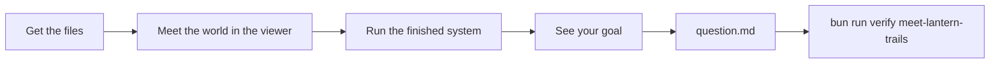
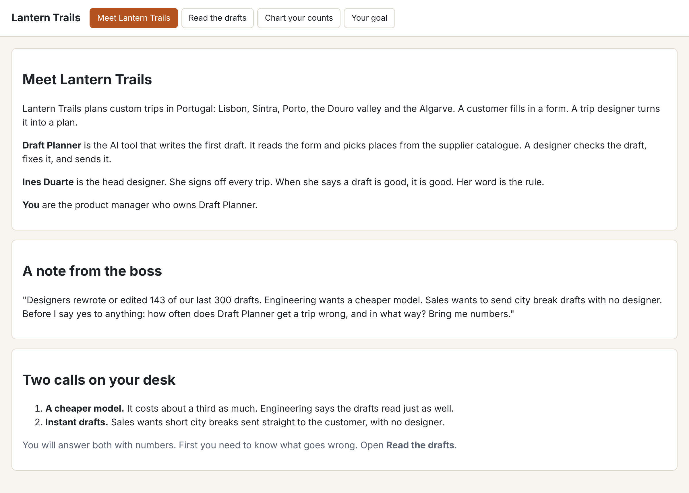
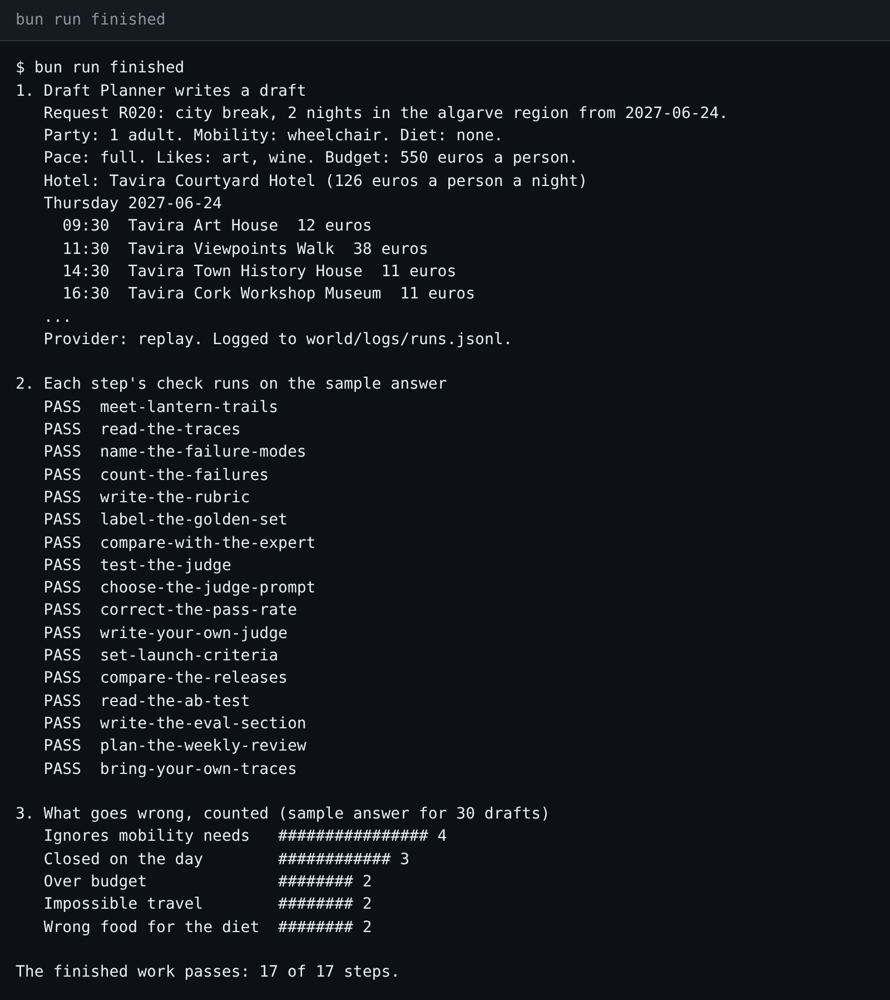

# Start here

Welcome! On this page you get the course ready on your computer. You meet Lantern Trails, the travel company in this course. You run the finished work and see your goal. Then you write down the one question you must answer.



## Set up

1. Get the files. On the GitHub page, click **Code**, then **Download ZIP**. Unzip the file. If you use git, you can clone the repo instead.
2. Install [Bun](https://bun.sh). Bun is a free tool that runs the checks. The Bun page gives you one line to copy and paste.
3. Open a terminal in the course folder. A terminal is a window where you type commands. Type each command below and press Enter.

```bash
bun install
```

Expect: `bun install` ends with no errors.

```bash
bun run world
```

Expect: `Lantern Trails is ready: 300 traces, 220 catalogue items, 300 requests.`

This command makes the course data. It also prints one more line: "Designers rewrote or edited 143 of 300 drafts. Nobody has counted why yet." That last part is your job.

## Meet the world

Open `world/viewer.html` with a double-click. It opens in your web browser. The page stays on your computer. Nothing is sent anywhere.

Read the **Meet Lantern Trails** tab. It tells you four things:

- who the company is;
- what Draft Planner, the AI tool, does;
- who Ines Duarte, the head designer, is;
- what the boss asked you.



## Run the finished system

Now see what the course looks like when all the work is done.

```bash
bun run finished
```

Expect: `The finished work passes: 17 of 17 steps.`



For example, the chart at the bottom shows the top problem: "Ignores mobility needs". This means a draft books steps for a traveller who cannot climb them. It happens in 4 of the 30 drafts. You make a chart like this yourself in part 1.

## See your goal

Open the **Your goal** tab in the viewer. It lists the launch pack you build, part by part. A launch pack is the set of files that shows if Draft Planner is ready to ship.

## Walkthrough

Your first step is [meet-lantern-trails](meet-lantern-trails/problem/README.md). Fill in `question.md` in that step's folder. Then run:

```bash
bun run verify meet-lantern-trails
```

Expect: `FAIL` lines, each with a `Try next:` line. That is the start: every step begins failing. Fill in `question.md` and run it again to see `Done. All 5 rules pass.`

Do not worry about the first `FAIL` lines. Every step starts that way. Each `Try next:` line tells you what to do.

Does a command print something you do not expect? Look up the words in [troubleshooting.md](troubleshooting.md).
