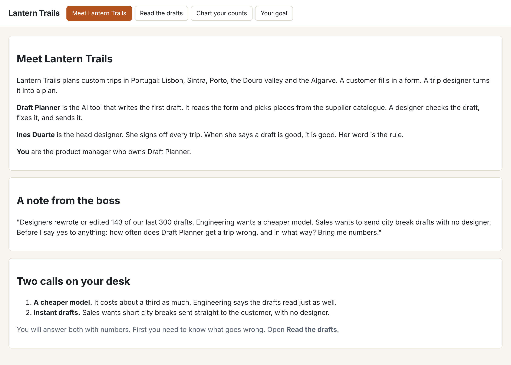

# Meet Lantern Trails

## The problem

Draft Planner is an AI tool. It writes trip drafts for Lantern Trails. Designers must fix many of these drafts before they go to the customer.

The boss must now make two choices:

- Should the company switch to a cheaper AI model?
- Should some drafts go to customers with no designer?

Nobody can say how often Draft Planner gets a trip wrong. So nobody can make these choices well.

Before you measure anything, you need to know two things. First, what question are you answering? Second, who decides what a "good" draft is?

Anthropic, a company that builds AI models, puts it this way: "The people closest to product requirements and users are best positioned to define success." ([Anthropic](https://www.anthropic.com/engineering/demystifying-evals-for-ai-agents)) In plain words: the person who knows the work best should decide what good means.



## Your challenge

1. Open `world/viewer.html` and read the **Meet Lantern Trails** tab.
2. Open `question.md` in this folder. Fill in both lines in your own words:
   - `Question:` the question the boss asked you. Start it with "How often".
   - `Who decides:` the person whose word sets what a good draft is.

A good question asks for a number. For example, `Question: Is Draft Planner good?` is a weak question. Nobody can answer it with a number. A question that starts with "How often" gets you a number, like "4 drafts in 30".

## Done when

- The world is in place: 300 drafts and 220 catalogue items.
- Draft Planner runs three times with no key and saves a record of every run.
- `question.md` is in this folder.
- The `Question:` line asks how often something goes wrong.
- The `Who decides:` line names the head designer, Ines Duarte.

Run the check:

```bash
bun run verify meet-lantern-trails
```

Expect: `Done. All 5 rules pass.` and a `Progress:` line.

## If you get stuck

Find the `FAIL` line you see in the left column. Then do the fix on the right.

| What you see                                         | Fix                                                                                      |
| ---------------------------------------------------- | ---------------------------------------------------------------------------------------- |
| `FAIL the world is in place`                         | Run `bun run world reset`.                                                               |
| `FAIL the Question: line asks how often`             | Start the line with `Question: How often` and write at least 6 words.                    |
| `FAIL the Who decides: line names the head designer` | The boss signs budgets, not trips. Read the tab again and find who signs off every trip. |

## Words you will use

- **Draft Planner**: the AI tool that writes a first trip draft from a customer form.
- **Trace**: the record of one Draft Planner run. It holds the request, what the tool looked up, and the draft it wrote.
- **Domain expert**: the person who knows the work best, so their view sets what good means. Here, that is Ines Duarte.
- **Replay**: a mode where Draft Planner gives back a reply it saved before. So you need no key.
- **Eval**: short for evaluation. A test that tells you how well an AI feature does its job.
