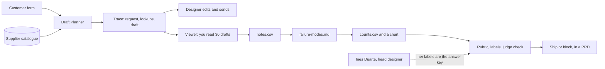

# AI Evals for PMs: the Lantern Trails launch pack

Walk into your next launch review with a number. You will learn to say how often an AI feature gets things wrong, what "good" means, and whether to ship. No code. No API key.

**Who it is for.** Product managers who own an AI feature, or will soon. Designers and analysts on AI teams are welcome too. You can use a spreadsheet: filters, sorting and a pivot table. You do not need to code.

**What you leave with.** A launch pack for one AI feature. It holds a chart of what goes wrong, a pass and fail rule, an AI grader you checked against an expert, two ship decisions with the numbers behind them, and the eval section of a product spec (a PRD). Every file in it is checked by a script.

## Run the finished system

You need [Bun](https://bun.sh) once, to run the checks. Everything else happens in a spreadsheet and a viewer you open with a double-click.

```bash
bun install
```

Expect: `bun install` ends with no errors.

```bash
bun run world
```

Expect: `Lantern Trails is ready: 300 traces, 220 catalogue items, 300 requests.`

```bash
bun run finished
```

Expect: `The finished work passes: 4 of 4 steps.`

`bun run finished` does three things with no key. Draft Planner (the AI feature) writes a trip draft. Each step's check runs on its sample answer. Then the sample counts print as a bar chart.


Now open `world/viewer.html` with a double-click. This is where you read the drafts.


## The world and what you build

**Lantern Trails** is a made-up company that plans custom trips in Portugal. A customer fills in a form. **Draft Planner**, an AI tool, writes a first draft from the supplier catalogue. A trip designer fixes it and sends it. **Ines Duarte**, the head designer, decides what a good draft is. You are the product manager who owns Draft Planner.



## The parts

| Part | What you make | Steps |
|---|---|---|
| [Orientation](00-orientation/README.md) | Set up, meet the world, write the question you must answer | meet-lantern-trails |
| [Look before you measure](parts/01-look-before-you-measure/README.md) | Notes on 30 drafts, named failure modes, counts and a chart | read-the-traces, name-the-failure-modes, count-the-failures |
| [Define good](parts/02-define-good/README.md) | A pass and fail rule, 40 labels, and a match with the expert | write-the-rubric, label-the-golden-set, compare-with-the-expert |
| [Check the judge](parts/03-check-the-judge/README.md) | A report card for three AI graders, and a judge prompt | test-the-judge, choose-the-judge-prompt, correct-the-pass-rate, write-your-own-judge |
| [Decide and write it down](parts/04-decide-and-write-it-down/README.md) | Launch rules, two ship calls, the eval section of a PRD | set-launch-criteria, compare-the-releases, read-the-ab-test, write-the-eval-section, plan-the-weekly-review, bring-your-own-traces |

Every step ends with one command that checks your file and tells you what to fix:

```bash
bun run verify read-the-traces
```

Expect: a `PASS` or `FAIL` line for each rule, then a `Progress:` line.

No terminal at work? Hand your files to your facilitator. They run the same command.

[PARTS.md](PARTS.md) lists every step, its minutes and what its check reads. [schedules.toml](schedules.toml) maps the parts onto one day or several sessions.

## The project

By the last step you have the **Lantern Trails launch pack**. Its headline: the cheaper model passes more drafts overall, but it fails many more wheelchair users. Your own launch rule blocks it. A hiring manager can read that in a minute: you looked past the average and showed the numbers.

## Read before you start

| Read | By | Why |
|---|---|---|
| [Demystifying evals for AI agents](https://www.anthropic.com/engineering/demystifying-evals-for-ai-agents) | Anthropic | Why the people closest to users should define success, and why you read the runs yourself |
| [The error-discovery skill](https://github.com/ai-evals-course/evals-skills/blob/main/skills/error-discovery/SKILL.md) | Hamel Husain and Shreya Shankar | The steps of reading traces and grouping notes, and why free-text notes beat dropdowns |
| [Define success criteria](https://platform.claude.com/docs/en/test-and-evaluate/develop-tests) | Anthropic docs | What a launch rule with a number looks like |

## Using a real model (optional)

The course never needs a key. To let Draft Planner call a real model, copy `.env.example` to `.env`, set `LLM_PROVIDER` to `anthropic`, `openrouter` or `openai`, and add that one key. Then:

```bash
bun run models
```

Expect: `Every role answers.` With no `.env`, it answers in `replay` mode, which uses recorded replies.

The rules every course repo follows are in [STANDARD.md](STANDARD.md).
