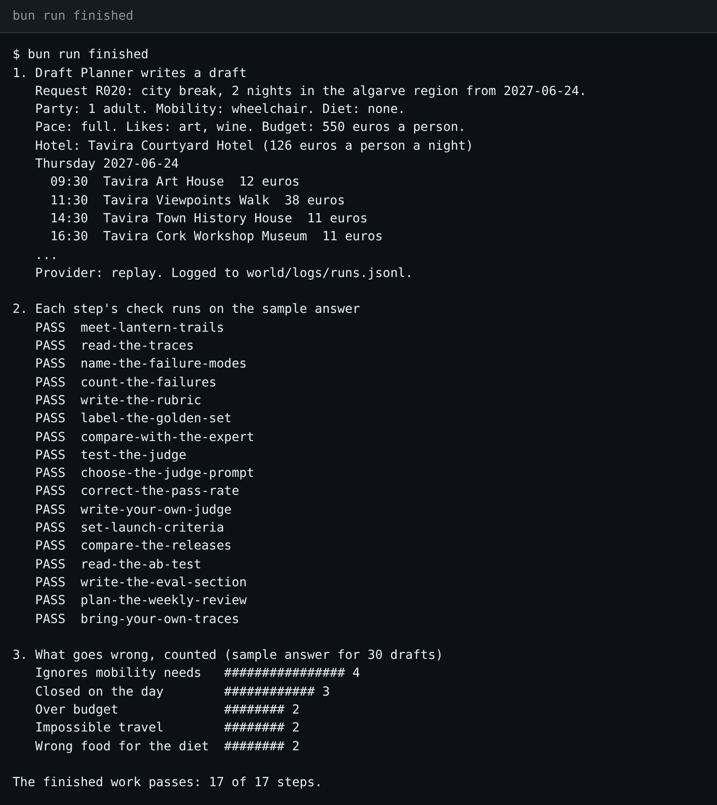
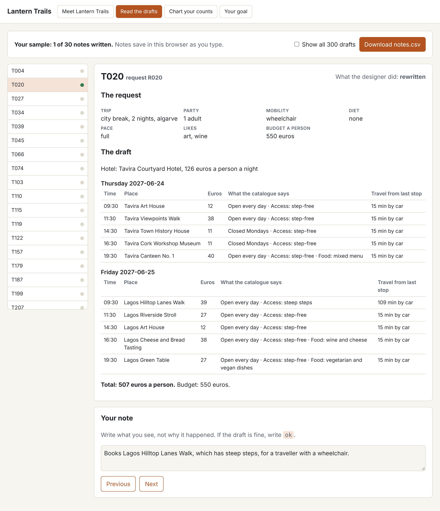
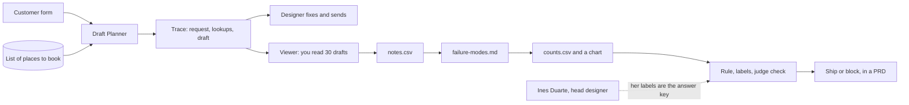

# AI Evals for PMs: the Lantern Trails launch pack

Your team wants to ship an AI feature. Someone asks: "How often does it get things wrong?" This course helps you answer with a number.

An **eval** (short for evaluation) is a test that tells you how well an AI feature does its job. In this course you build evals by reading, sorting and counting. You use a spreadsheet, not code. You do not need an API key.

**Who it is for.** You are a product manager who owns an AI feature, or soon will. Designers and analysts on AI teams are welcome too. You need to know a few spreadsheet tools: filters, sorting and a pivot table. You do not need to code.

**What you leave with.** You leave with a **launch pack** for one AI feature. A launch pack is a set of files that shows if the feature is ready to ship. It holds:

- a chart of what goes wrong, and how often;
- a rule that says when a draft passes and when it fails;
- an AI grader that you checked against a human expert;
- two ship decisions, with the numbers behind them;
- the eval part of a product spec (a PRD, or product requirements document).

A script checks every file you make, so you always know where you stand.

## Run the finished system

First, see the finished work. You need [Bun](https://bun.sh) for this. Bun is a free tool that runs the checks. You install it once. After that, you work in a spreadsheet and in a viewer page that you open with a double-click.

Open a terminal in the course folder. A terminal is a window where you type commands. Type each command below and press Enter.

```bash
bun install
```

Expect: `bun install` ends with no errors.

```bash
bun run world
```

Expect: `Lantern Trails is ready: 300 traces, 220 catalogue items, 300 requests.`

```bash
bun run finished
```

Expect: `The finished work passes: 17 of 17 steps.`

`bun run finished` does three things, with no key:

1. Draft Planner, the AI tool in this course, writes one trip draft.
2. Each step's check runs on a sample answer, and each one passes.
3. The sample counts print as a bar chart.



Now open `world/viewer.html` with a double-click. It opens in your web browser. This is where you read the drafts.



## The world and what you build

**Lantern Trails** is a made-up travel company. It plans trips in Portugal. This is how a trip gets made:

1. A customer fills in a form. They say where they want to go, their budget, and what they need.
2. **Draft Planner**, an AI tool, writes a first draft of the trip. It picks hotels, walks and meals from the list of places the company can book.
3. A trip designer fixes the draft and sends it to the customer.
4. **Ines Duarte** is the head designer. She decides what a good draft is.

You are the product manager who owns Draft Planner.

For example, run this command. Draft Planner writes a trip for request R020.

```bash
bun run draft R020
```

Expect: `Draft Planner wrote a draft for R020 (provider: replay). Logged to world/logs/runs.jsonl.`

The request says the traveller uses a wheelchair. But on Friday, the draft books the "Lagos Hilltop Lanes Walk". The list of places says this walk has steep steps. A designer must fix this. In this course, you find mistakes like this one, give them names, and count them.

Each run of Draft Planner leaves a **trace**. A trace is the full record of one run: the request, what the tool looked up, and the draft it wrote.



## The parts

The course has an orientation and four parts. Each part has short steps.

| Part                                                                                                | What you make                                                                           | Steps                                                                                                                                                  | Part minutes |
| --------------------------------------------------------------------------------------------------- | --------------------------------------------------------------------------------------- | ------------------------------------------------------------------------------------------------------------------------------------------------------ | ------------ |
| [Orientation](00-orientation/README.md)                                                             | Set up, meet the world, write the question you must answer                              | meet-lantern-trails                                                                                                                                    | 15           |
| [Look before you measure](parts/01-look-before-you-measure/README.md)                               | Notes on 30 drafts, named failure modes, counts and a chart                             | read-the-traces, name-the-failure-modes, count-the-failures, break-down-the-stages                                                                     | 70           |
| [Define good](parts/02-define-good/README.md)                                                       | A pass and fail rule, 40 labels, and a match with the expert                            | write-the-rubric, label-the-golden-set, compare-with-the-expert                                                                                        | 50           |
| [Check the judge](parts/03-check-the-judge/README.md)                                               | A report card for three AI graders, and a judge prompt                                  | test-the-judge, choose-the-judge-prompt, correct-the-pass-rate, write-your-own-judge                                                                   | 80           |
| [Decide and write it down](parts/04-decide-and-write-it-down/README.md)                             | Launch rules, two ship calls, the eval section of a PRD                                 | set-launch-criteria, compare-the-releases, read-the-ab-test, write-the-eval-section, plan-the-weekly-review, bring-your-own-traces, ship-your-own-eval | 150          |
| [Review answers with the Langfuse queue](parts/05-review-answers-with-the-langfuse-queue/README.md) | The 40 labels again, in a queue that teams use. Optional in class, expected as homework | label-the-queue-rows                                                                                                                                   | 20           |

Every step ends with one command. It checks your file and tells you what to fix. For example:

```bash
bun run verify read-the-traces
```

Expect: a `PASS` or `FAIL` line for each rule, then a `Progress:` line.

Each `FAIL` line comes with a `Try next:` line. It tells you what to do.

No terminal at work? Give your files to your teacher. They run the same command for you.

[PARTS.md](PARTS.md) lists every step, how many minutes it takes, and what its check reads. [schedules.toml](schedules.toml) shows how to fit the parts into one day or into several shorter sessions.

## The project

At the end, you have the **Lantern Trails launch pack**. Here is its main finding. A cheaper AI model passes more drafts in total. But it fails many more travellers who use a wheelchair. Your own launch rule blocks it.

Someone who hires you can read that in a minute. It shows that you looked past the average and backed your call with numbers.

## Read before you start

These three short pages explain the ideas behind the course.

| Read                                                                                                                   | By                              | Why                                                                                       |
| ---------------------------------------------------------------------------------------------------------------------- | ------------------------------- | ----------------------------------------------------------------------------------------- |
| [Demystifying evals for AI agents](https://www.anthropic.com/engineering/demystifying-evals-for-ai-agents)             | Anthropic                       | Why the people closest to users should define success, and why you read the runs yourself |
| [The error-discovery skill](https://github.com/ai-evals-course/evals-skills/blob/main/skills/error-discovery/SKILL.md) | Hamel Husain and Shreya Shankar | The steps of reading traces and grouping notes, and why free-text notes beat dropdowns    |
| [Define success criteria](https://platform.claude.com/docs/en/test-and-evaluate/develop-tests)                         | Anthropic docs                  | What a launch rule with a number looks like                                               |

## Using a real model (you can skip this)

You never need a key for this course. Draft Planner uses replies that were recorded before. We call this **replay** mode.

If you want Draft Planner to call a real AI model, do this:

1. Copy the file `.env.example` and name the copy `.env`.
2. In `.env`, set `LLM_PROVIDER` to `anthropic`, `openrouter` or `openai`.
3. Add the key for that one provider.

Then run:

```bash
bun run models
```

Expect: `Every role answers.` With no `.env`, it answers in `replay` mode, which uses recorded replies.

The rules that every course repo follows are in [STANDARD.md](STANDARD.md).
