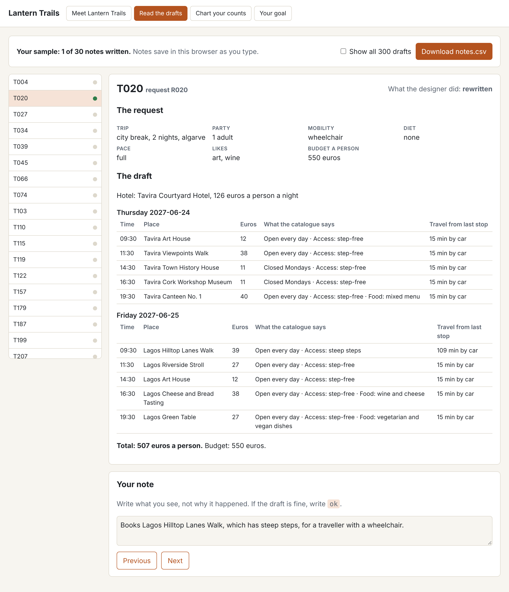

# Read the traces

## The problem

Lantern Trails has 300 drafts. Designers rewrote or edited 143 of them, but nobody knows which were bad, or why. For example, draft T020 books a steep walk for a traveller who uses a wheelchair. Read the drafts first. Do not start with a list of problems.

## Watch it done

Before: the check prints `FAIL notes.csv is in this folder`.
After: the check prints `Done. All 6 rules pass.`



## Your turn

A trace is the record of one Draft Planner run. An open note is a few words, in your own words, about what went wrong.

1. Open `world/viewer.html` and click **Read the drafts**. The list on the left shows your 30 drafts.
2. For each draft, compare it with the request at the top. Check the budget, closed days, walking, food, and travel time between stops.
3. Write one note in the box:
   - If something is wrong, say what you see in 6 words or more. Do not guess why it happened.
   - If the draft is fine, write `ok`.
4. Click **Download notes.csv**. Move the file into this `problem` folder. It takes the place of the starter file.
5. Run the check:

```bash
bun run verify read-the-traces
```

Expect: `Done. All 6 rules pass.` and a `Progress:` line.

For draft T020, the request says the traveller uses a wheelchair. The draft books the "Lagos Hilltop Lanes Walk", and the list of places says it has steep steps. A good note: "Books a steep walk for a traveller in a wheelchair." A weak note: "bad" does not say what is wrong. "The model was confused" is a guess about why.

If the check fails:

- FAIL notes.csv is in this folder: your browser saved the file in Downloads. Move it here.
- FAIL it has the 30 drafts from your sample: do not add or remove rows.
- FAIL every note is filled in: write what you saw, or `ok`, for each short note.
- FAIL you spotted most of the drafts with a real problem: check the drafts you marked `ok` against the request.
- FAIL you did not flag every draft: if a draft is fine, write `ok`.

You can also fill in `notes.csv` in a spreadsheet. Save it as CSV.

## Do it on your work

Pick a few past runs, such as chat logs. Write one note for each: a few words on what you saw, or `ok`. Good looks like: each note says what you saw, not why it happened, and not every run is marked as a problem.

## Done when

- `notes.csv` is in this folder.
- It has the columns `trace_id` and `note`.
- It has the 30 drafts from your sample, each one once.
- Every note is the word `ok`, or at least 6 words that say what you saw.
- You spotted (found) most of the drafts with a real problem.
- You did not flag (mark as a problem) every draft: at least 5 notes say `ok`.

## Solution

`solution/notes.csv` holds a finished file for the 30 drafts. Each row has either `ok` or a note that says what was seen.
