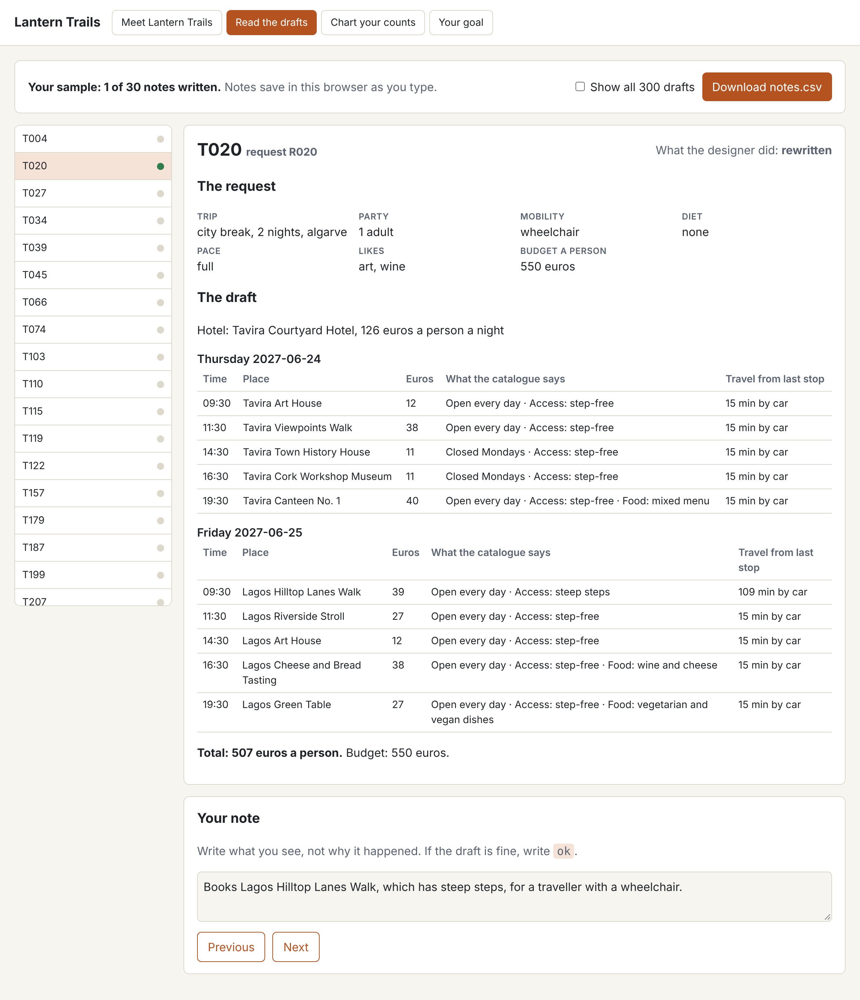

# Read the traces

## The problem

You have 30 drafts to read. Some are fine. Some have a problem that a designer had to fix. You do not know yet what kinds of problems there are.

If you start with a list of problems, you only find the ones on your list. So you read first, and write what you see.



## Your challenge

1. Open `world/viewer.html` and click **Read the drafts**. The list on the left shows your 30 drafts.
2. For each draft, compare the draft with the request at the top. Check the budget, closed days, walking, food, and travel time between stops.
3. Write one note in the box:
   - If something is wrong, say what you see in 6 words or more. Do not guess why it happened.
   - If the draft is fine, write `ok`.
4. Click **Download notes.csv**. Move the file into this `problem` folder. It takes the place of the starter file.

For example, open draft T020. The request says the traveller uses a wheelchair. On Friday, the draft books the "Lagos Hilltop Lanes Walk". The list of places says this walk has steep steps.

- A good note: "Books a steep walk for a traveller in a wheelchair." It says what you see.
- A weak note: "bad". It does not say what is wrong.
- Another weak note: "the model was confused". It is a guess about why. Write what you see, not why you think it happened.

## Done when

- `notes.csv` is in this folder.
- It has the columns `trace_id` and `note`.
- It has the 30 drafts from your sample, each one once.
- Every note is the word `ok`, or at least 6 words that say what you saw.
- You spotted (found) most of the drafts with a real problem.
- You did not flag (mark as a problem) every draft: at least 5 notes say `ok`.

Run the check:

```bash
bun run verify read-the-traces
```

Expect: `Done. All 6 rules pass.` and a `Progress:` line.

## If you get stuck

Find your `FAIL` line on the left. Do the fix on the right.

| What you see                                              | Fix                                                                            |
| --------------------------------------------------------- | ------------------------------------------------------------------------------ |
| `FAIL notes.csv is in this folder`                        | Your browser saved the file in your Downloads folder. Move it here.            |
| `FAIL it has the 30 drafts from your sample`              | Do not add or remove rows. Start again from the starter `notes.csv` if needed. |
| `FAIL every note is filled in`                            | Find the empty or short notes. Write what you saw, or `ok`.                    |
| `FAIL you spotted most of the drafts with a real problem` | Open the drafts you marked `ok`. Check each fact against the request.          |
| `FAIL you did not flag every draft`                       | A note is for something a designer would fix. If a draft is fine, write `ok`.  |

You can also fill in `notes.csv` in a spreadsheet. Save it as CSV.

## Words you will use

- **Trace**: the record of one Draft Planner run. It holds the request, what the tool looked up, and the draft.
- **Sample**: a small part of a big pile that you read in full. Here, you read 30 of the 300 drafts.
- **Open note**: a few words, in your own words, about what went wrong. You do not pick from a fixed list.
