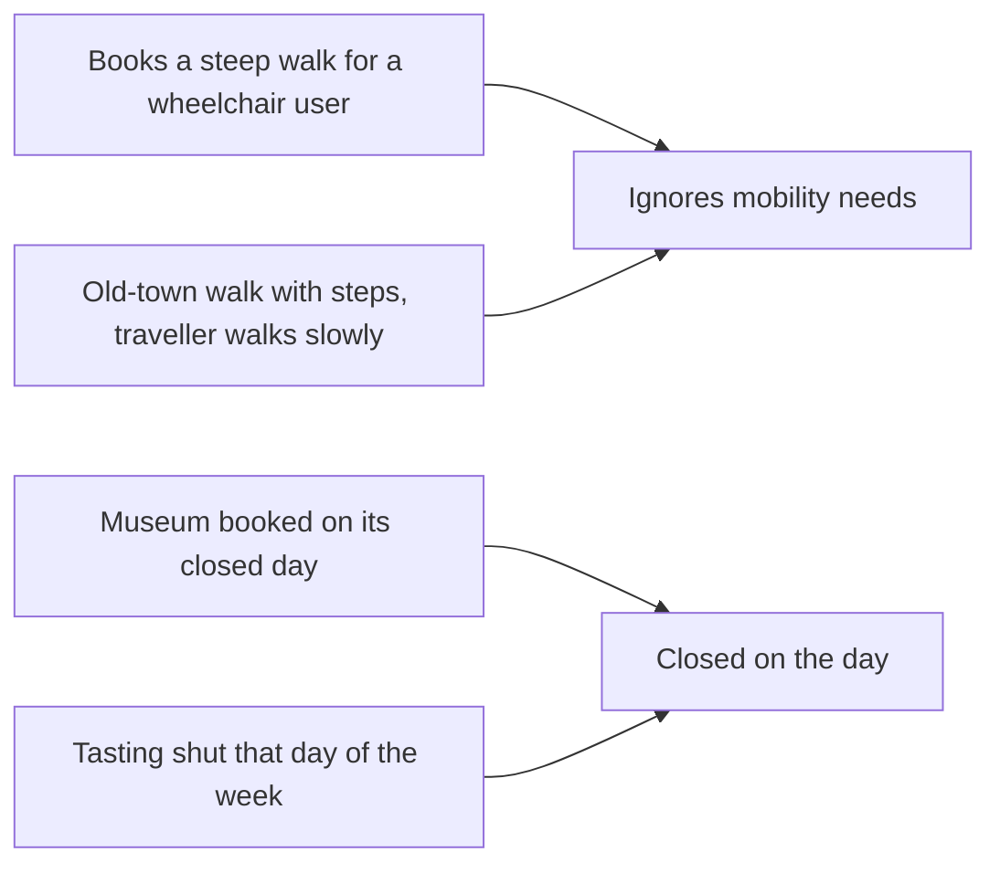

# Name the failure modes

## The problem

You have 30 notes. Many say the same thing in different words. A list of 30 notes is hard to act on. A short list of named problems is easy: an engineer can fix one, and you can count each one.



## Your challenge

This folder has a `notes.csv` filled in for you, so you can start even if you skipped the last step. If you want to use your own notes, copy your `notes.csv` from `read-the-traces` over it.

1. Read every note that is not `ok`.
2. Put notes that describe the same problem into one group. Aim for 4 to 8 groups.
3. Open `failure-modes.md`. For each group, write:
   - `## ` and a short name that says what happened, like `## Closed on the day`.
   - `Definition:` one sentence a designer could use to spot it.
   - `Traces:` the ids of the drafts in this group, like `T020, T199`.

Name what happened, not how it felt. "Quality" or "Accuracy" tells an engineer nothing.

## Done when

- `notes.csv` from the last step is in this folder.
- `failure-modes.md` is in this folder.
- It names 4 to 8 failure modes, each under its own `##` heading.
- Every mode has a `Definition:` line of at least 6 words.
- Every mode lists at least 2 drafts on its `Traces:` line.
- Every draft you list has a note that is not `ok`.
- No mode is named with only a vague word like quality or accuracy.
- Together the modes cover at least 8 in 10 of your notes that are not `ok`.

```bash
bun run verify name-the-failure-modes
```

Expect: `Done. All 8 rules pass.` and a `Progress:` line.

## If you get stuck

| What you see | Fix |
|---|---|
| `FAIL it names 4 to 8 failure modes` | Two big groups hide the detail. Split a group if it mixes two problems. |
| `FAIL every mode lists at least 2 drafts` | Merge a group of one into the group it is most like. |
| `FAIL no mode is named with only a vague word` | Rename it after what happened, like `Over budget`. |
| `FAIL together the modes cover at least 8 in 10` | Some notes are in no group. Add each to the group it fits. |

A note that is not a real problem, like "a bit slow", can stay out of every group.

## Words you will use

- **Failure mode**: one kind of thing that goes wrong, with a name and a definition.
- **Definition**: one sentence that lets someone else decide if a draft has this problem.
- **Coverage**: how many of your notes belong to some named mode.
