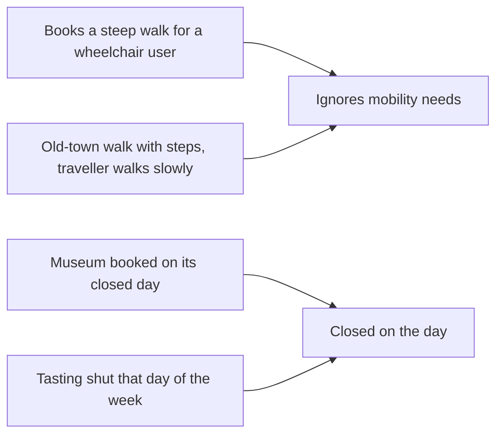

# Name the failure modes

## The problem

You have 30 notes. Many say the same thing in different words, so a list of 30 is hard to act on. For example, four notes became two failure modes. A failure mode is one named kind of problem, with a short definition.

## Watch it done

Before: the check prints `FAIL it names 4 to 8 failure modes`.
After: the check prints `Done. All 8 rules pass.`

## Your turn

This folder has a filled-in `notes.csv`. Start now, or copy your own `notes.csv` from `read-the-traces` over it.

1. Read every note that is not `ok`.
2. Put notes about the same problem into one group. Aim for 4 to 8 groups.
3. Open `failure-modes.md`. For each group, write:
   - `## ` and a short name, like "Closed on the day".
   - `Definition:` one sentence that helps a designer spot the problem.
   - `Traces:` the ids of the drafts in this group, like `T020, T199`.

For example, these four notes become two failure modes:



One finished group looks like this:

```text
## Ignores mobility needs

Definition: The draft books a place with steps for a traveller who uses a wheelchair or cannot walk far.
Traces: T020, T199, T207, T255
```

Name what happened, not how it felt. "Quality" or "Accuracy" tells an engineer nothing. "Closed on the day" tells them what to fix.

Notes like "a bit slow" can stay out of every group.

4. Run the check:

```bash
bun run verify name-the-failure-modes
```

Expect: `Done. All 8 rules pass.` and a `Progress:` line.

If the check fails:

- FAIL it names 4 to 8 failure modes: split a group if it mixes two problems.
- FAIL every mode lists at least 2 drafts: move a group of one into the closest group.
- FAIL no mode is named with only a vague word: name what happened, like Over budget.
- FAIL together the modes cover at least 8 in 10: add each missing note to its group.

## Do it on your work

Group your own notes into 4 to 8 named problems, each with a definition. Good looks like: each name says what happened, each group has at least two drafts, and most notes sit in a group.

## Done when

- `notes.csv` from the last step is in this folder.
- `failure-modes.md` is in this folder.
- It names 4 to 8 failure modes, each under a `##` heading.
- Every mode has a `Definition:` line of at least 6 words.
- Every mode lists at least 2 drafts on its `Traces:` line.
- Every draft you list has a note that is not `ok`.
- No mode is named with only a vague word like quality or accuracy.
- Together the modes cover at least 8 in 10 of your notes that are not `ok`.

## Solution

`solution/failure-modes.md` holds a finished set of groups.
