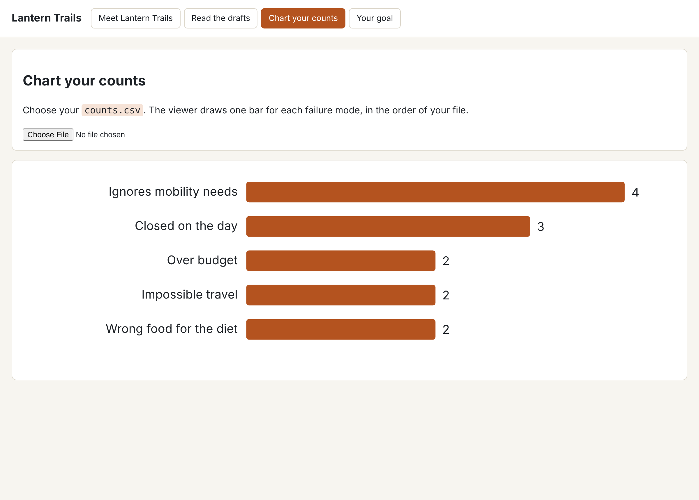

# Count the failures

## The problem

You know what goes wrong. You do not know how often. The boss asked "how often?", so you need a number for each failure mode. A count also shows which problem to fix first.



## Your challenge

This folder has a filled-in `notes.csv` and `failure-modes.md`. Copy your own over them if you want to use your work.

1. Open `notes.csv` in a spreadsheet. Add a third column called `mode`.
2. For each note that is not `ok`, type the name of its failure mode, exactly as it is in `failure-modes.md`. If a note is not a real problem, type `none`. Leave `ok` rows empty.
3. Make a pivot table: rows are `mode`, values are the count of `trace_id`. Leave out `none` and empty.
4. Sort it from the biggest count to the smallest. Save it as `counts.csv` with two columns: `mode` and `count`.
5. In `top-mode.md`, write one sentence that names the top mode and its count.
6. Open the **Chart your counts** tab in the viewer and choose your `counts.csv`. Compare your chart with the picture above.

Save every file as CSV or plain text, in this folder.

## Done when

- `notes.csv` in this folder has a `mode` column.
- Every note that is not `ok` has a mode, or the word `none` if it is not a failure.
- Every mode you used is a heading in `failure-modes.md`.
- `counts.csv` has a `mode` column and a `count` column, one row for each mode you used.
- Each count matches the number of notes with that mode.
- `counts.csv` runs from the biggest count to the smallest.
- `top-mode.md` names the mode at the top of `counts.csv` and its count.

```bash
bun run verify count-the-failures
```

Expect: `Done. All 7 rules pass.` and a `Progress:` line.

## If you get stuck

| What you see | Fix |
|---|---|
| `FAIL every mode you used is a heading` | A spelling change makes a new mode. Copy the names from `failure-modes.md`. |
| `FAIL each count matches` | Build the pivot table again from `notes.csv`, not by hand. |
| `FAIL counts.csv runs from the biggest count` | Sort by `count`, largest first. |
| `FAIL top-mode.md names the mode at the top` | Use the first row of `counts.csv`, and write its number. |

## Words you will use

- **Pivot table**: a spreadsheet tool that counts rows by a column. Google Sheets, Excel and LibreOffice all have one.
- **Count**: how many drafts in your sample show one failure mode.
- **Top mode**: the failure mode with the biggest count. It is usually the first thing to fix.
