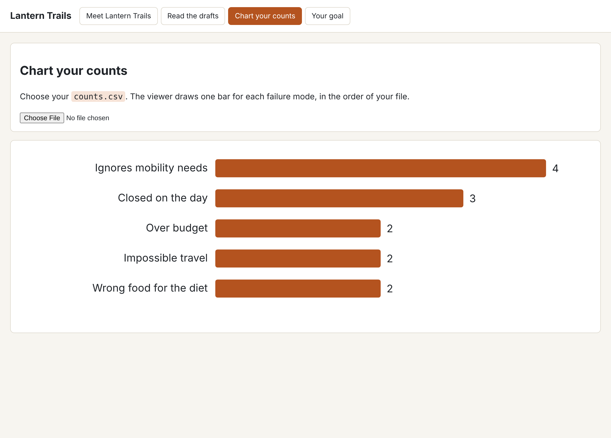

# Count the failures

## The problem

You know what goes wrong, but not how often. For each failure mode, you need a count. For example, in the sample answer, Ignores mobility needs is the top mode, with 4 drafts out of 30.

## Watch it done

Before: the check prints `FAIL each count matches`.
After: the check prints `Done. All 7 rules pass.`



## Your turn

This folder has a filled-in `notes.csv` and `failure-modes.md`. To use your own, copy yours in their place.

1. Open `notes.csv` in a spreadsheet. Add a third column called `mode`.
2. For each note that is not `ok`, type the name of its failure mode. Spell it the same as in `failure-modes.md`. If a note is not a real problem, type `none`. Leave the `ok` rows empty.
3. Make a pivot table. Put `mode` in the rows. Use the count of `trace_id` as the values. Leave out `none` and empty rows.
4. Sort the table from the biggest count to the smallest. Save it as `counts.csv`, with two columns: `mode` and `count`.
5. In `top-mode.md`, write one sentence. Name the top mode and its count.
6. Open the **Chart your counts** tab in the viewer and choose your `counts.csv`. Compare your chart with the picture above.

Save every file as CSV or plain text, in this folder.

For example, the sample answer finds five modes. Its `counts.csv` looks like this:

```text
mode,count
Ignores mobility needs,4
Closed on the day,3
Over budget,2
Impossible travel,2
Wrong food for the diet,2
```

So its `top-mode.md` says: "The top failure mode is Ignores mobility needs, with 4 drafts out of 30."

Your numbers will differ.

7. Run the check:

```bash
bun run verify count-the-failures
```

Expect: `Done. All 7 rules pass.` and a `Progress:` line.

If the check fails, do the fix on your FAIL line:

- FAIL every mode you used is a heading: a small spelling change makes a new mode. Copy the names from `failure-modes.md`.
- FAIL each count matches: make the pivot table again from `notes.csv`. Do not count by hand.
- FAIL counts.csv runs from the biggest count: sort by `count`, with the biggest first.
- FAIL top-mode.md names the mode at the top: use the first row of `counts.csv`, and write its number.

## Do it on your work

Count the modes in your own notes with a pivot table, not by hand. Good looks like: every count matches your pivot table, the list runs from biggest to smallest, and `top-mode.md` names the top row in one sentence.

## Done when

- `notes.csv` in this folder has a `mode` column.
- Every note that is not `ok` has a mode, or the word `none` if it is not a failure.
- Every mode you used is a heading in `failure-modes.md`.
- `counts.csv` has a `mode` column and a `count` column, one row for each mode you used.
- Each count matches the number of notes with that mode.
- `counts.csv` runs from the biggest count to the smallest.
- `top-mode.md` names the mode at the top of `counts.csv` and its count.

## Solution

`solution/counts.csv` and `solution/top-mode.md` hold the finished counts and the top mode sentence.
