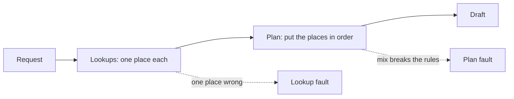

# Break down the stages

## The problem

Draft Planner looks up places one at a time, then plans the trip. If you only grade the final draft, you cannot tell which stage to fix. T020 fails, but the fault sits in one lookup.

## Your challenge

This folder has `stages.csv` with 5 drafts that have a real fault, a small `rag.csv` for a search app, and an empty `breakdown.md`.

1. Open a draft in the viewer: `world/viewer.html#read/T020`. Read the list of lookups. Each lookup asks for one place and gets one back.
2. For each id in `stages.csv`, ask one question. Is one place wrong by itself, like steep steps for a wheelchair or a closed day? That is a `lookup` fault. Or are all the places fine alone, but together they break the budget, the pace or the travel time? That is a `plan` fault.
3. Fill the `stage` column with `lookup` or `plan`.
4. For a lookup fault, write the number of the lookup that returned the bad place in `lookup_number`. Count from 1. Leave it empty for a plan fault.
5. Add a short `reason` for each row.
6. Open `rag.csv`. It is a help bot that searches for a page, then answers. Fill the `stage` column. Write `search` when `page_found` is not `page_needed`. Write `answer` when the page is right but `answer_matches_page` is `no`. Write `none` for the rest.
7. In `breakdown.md`, write how many faults sit in each stage, for the drafts and for the help bot. Then write one `Fix first:` line that names a stage and says why.

For example, T020 says: "Lagos Hilltop Lanes Walk has steep steps, and the traveller uses a wheelchair." That place came back on lookup 7. So the row is `T020,lookup,7`.



An agent has the same cut per step: grade each tool call, then the whole run.

Go further: add the other 8 drafts with a fault from your sample of 30 as new rows.

## Done when

- `stages.csv` has a row for each of the 5 drafts.
- Each fault is marked `lookup` or `plan`, and most are right.
- Each lookup fault names the number of the lookup that went wrong.
- `rag.csv` marks each question as search, answer or none.
- `breakdown.md` has `Lookup faults:`, `Plan faults:`, `Search faults:` and `Answer faults:` counts that match your rows.
- A `Fix first:` line names a stage and says why.

```bash
bun run verify break-down-the-stages
```

Expect: `Done. All 6 rules pass.` and a `Progress:` line.

## If you get stuck

| What you see                          | Fix                                                                                  |
| ------------------------------------- | ------------------------------------------------------------------------------------ |
| `FAIL each fault is marked`           | Over budget, impossible travel and wrong pace are plan faults. The rest are lookups. |
| `FAIL each lookup fault names`        | Count the lookup list from 1, and use the one that returned the place in the fault.  |
| `FAIL breakdown.md has Lookup faults` | Count the rows of `stages.csv` for each stage.                                       |

## Words you will use

- **Lookup fault**: one place is wrong by itself.
- **Plan fault**: the places are fine alone but the plan breaks a rule.
- **RAG**: an app that searches for pages first, then writes an answer from them.
