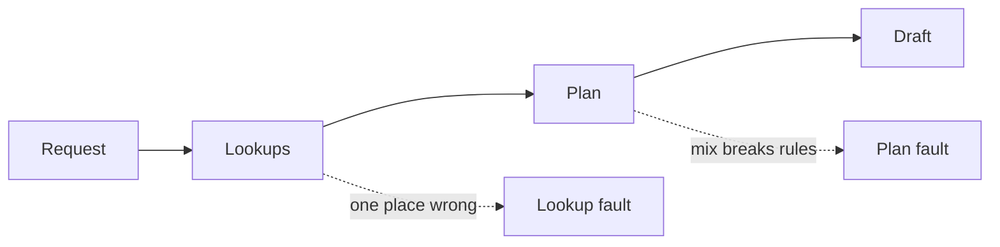

# Break down the stages

## The problem

Draft Planner looks up places one at a time, then plans the trip. If you only grade the final draft, you cannot tell which stage to fix. For example, T020 fails, but the bad place came back on lookup 7.

## Watch it done

Before: the check prints `FAIL each fault is marked`.
After: the check prints `Done. All 6 rules pass.`

## Your turn

This folder has `stages.csv` with 5 drafts that have a real fault, a small `rag.csv`, and an empty `breakdown.md`. A lookup fault is one place that is wrong by itself. A plan fault is a plan that breaks a rule.

1. Open a draft in the viewer: `world/viewer.html#read/T020`. Read the lookups.
2. For each id in `stages.csv`, ask: is one place wrong by itself? That is a `lookup` fault. If the places are fine alone but break the budget, the pace or the travel time, that is a `plan` fault.
3. Fill the `stage` column with `lookup` or `plan`.
4. For a lookup fault, write the number of the lookup that returned the bad place in `lookup_number`. Count from 1. Leave it empty for a plan fault.
5. Add a short `reason` for each row.
6. Open `rag.csv`. RAG is an app that searches for a page, then writes an answer from it. Fill the `stage` column. Write `search` when `page_found` is not `page_needed`. Write `answer` when the page is right but `answer_matches_page` is `no`. Write `none` for the rest.
7. In `breakdown.md`, write how many faults sit in each stage, for the drafts and for the help bot. Then write one `Fix first:` line that names a stage and says why.

T020 says: "Lagos Hilltop Lanes Walk has steep steps, and the traveller uses a wheelchair." That place came back on lookup 7. So the row is `T020,lookup,7`.



8. Run the check:

```bash
bun run verify break-down-the-stages
```

Expect: `Done. All 6 rules pass.` and a `Progress:` line.

If the check fails:

- FAIL each fault is marked: over budget, impossible travel and wrong pace are plan faults. The rest are lookups.
- FAIL each lookup fault names: count the lookups from 1, and use the one that returned the place.
- FAIL breakdown.md has Lookup faults: count the rows for each stage.

## Do it on your work

Pick one fault from your own runs and ask the same question. Good looks like: each row has `lookup` or `plan`, and each lookup row names the lookup number.

Go further: add the other 8 drafts from your sample of 30 as new rows.

## Done when

- `stages.csv` has a row for each of the 5 drafts.
- Each fault is marked `lookup` or `plan`, and most are right.
- Each lookup fault names the number of the lookup that went wrong.
- `rag.csv` marks each question as search, answer or none.
- `breakdown.md` has `Lookup faults:`, `Plan faults:`, `Search faults:` and `Answer faults:` counts that match your rows.
- A `Fix first:` line names a stage and says why.

## Solution

`solution/stages.csv`, `solution/rag.csv` and `solution/breakdown.md` hold the finished files.
