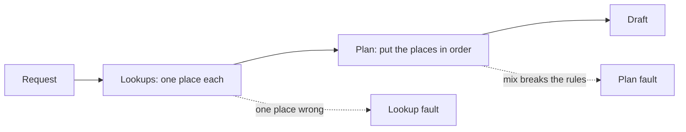

# Break down the stages

## The problem

Draft Planner is not one step. It looks up places one at a time, then plans the trip from what it found. A search app or an agent works the same way. If you only grade the final draft, you cannot tell which stage to fix. T020 fails, but the fault sits in one lookup.

## Your challenge

This folder has `stages.csv` with the 13 drafts in your sample that have a real fault. It also has an empty `breakdown.md`.

1. Open a draft in the viewer: `world/viewer.html#read/T020`. Read the list of lookups. Each lookup asks for one place and gets one back.
2. For each id in `stages.csv`, ask one question. Is one place wrong by itself, like steep steps for a wheelchair or a closed day? That is a `lookup` fault. Or are all the places fine alone, but together they break the budget, the pace or the travel time? That is a `plan` fault.
3. Fill the `stage` column with `lookup` or `plan`.
4. For a lookup fault, write the number of the lookup that returned the bad place in `lookup_number`. Count from 1. Leave it empty for a plan fault.
5. Add a short `reason` for each row.
6. In `breakdown.md`, write how many faults sit in each stage. Then write one `Fix first:` line that names a stage and says why.

For example, T020 says: "Lagos Hilltop Lanes Walk has steep steps, and the traveller uses a wheelchair." That place came back on lookup 7. So the row is `T020,lookup,7`.



For a RAG app, the same cut is search versus answer. Did the search bring back the wrong page, or did the answer misuse a good page? For an agent, it is the same cut per step: grade each tool call, then the whole run.

## Done when

- `stages.csv` has a row for every real fault in your sample.
- Each fault is marked `lookup` or `plan`, and most are right.
- Each lookup fault names the number of the lookup that went wrong.
- `breakdown.md` has `Lookup faults:` and `Plan faults:` counts that match your rows.
- A `Fix first:` line names a stage and says why.

```bash
bun run verify break-down-the-stages
```

Expect: `Done. All 5 rules pass.` and a `Progress:` line.

## If you get stuck

| What you see                          | Fix                                                                                  |
| ------------------------------------- | ------------------------------------------------------------------------------------ |
| `FAIL each fault is marked`           | Over budget, impossible travel and wrong pace are plan faults. The rest are lookups. |
| `FAIL each lookup fault names`        | Count the lookup list from 1, and use the one that returned the place in the fault.  |
| `FAIL breakdown.md has Lookup faults` | Count the rows of `stages.csv` for each stage.                                       |

## Words you will use

- **Stage**: one part of a longer job. Here, the lookups and the plan.
- **Lookup fault**: one place is wrong by itself.
- **Plan fault**: the places are fine alone but the plan breaks a rule.
- **RAG**: an app that searches for pages first, then writes an answer from them.
