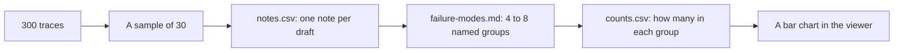

# Look before you measure

## The problem

Lantern Trails has 300 drafts from Draft Planner. Designers rewrote or edited 143 of them. But nobody knows which drafts were bad, or why.

A score on a dashboard, like "4.1 out of 5", does not help. It tells you nothing about what went wrong. The only way to find out is in three moves:

1. Read the drafts yourself.
2. Write down what you see.
3. Count.

In this part you do all three. You start with no list of problems. You find the problems by reading.

For example, draft T020 is for a traveller who uses a wheelchair. On Friday, it books the "Lagos Hilltop Lanes Walk". The list of places says this walk has steep steps. You write a short note about it, like this one: "Books a walk with steep steps for a traveller with a wheelchair".

Later, you put notes like this into a group called "Ignores mobility needs". Then you count the group.

## Why it matters

Teams that read the runs find what the numbers hide. Here is a real case. Anthropic tested one of its own models on a test called CORE-Bench. The first score was 42%. Then a researcher read the runs one by one. The grading was broken. For example, it marked "96.12" as wrong when it wanted "96.124991". After the fixes, the score was 95%.

Anthropic's advice, in one line: "Read the transcripts!" ([Anthropic, Demystifying evals for AI agents](https://www.anthropic.com/engineering/demystifying-evals-for-ai-agents)) A transcript is the full record of a run. In this course we call it a trace.

Hamel Husain and Shreya Shankar teach a well-known course on evals. They give the same order: read first, write notes in your own words, then group the notes. In their words: "No quality labels, no dropdowns, no structured forms. Free-text notes only." ([error-discovery skill](https://github.com/ai-evals-course/evals-skills/blob/main/skills/error-discovery/SKILL.md))

This is the path you take in this part:



## Steps

| Step                                                                  | Minutes | You make                                 | The check reads                                                                            |
| --------------------------------------------------------------------- | ------- | ---------------------------------------- | ------------------------------------------------------------------------------------------ |
| [read-the-traces](01-read-the-traces/problem/README.md)               | 25      | `notes.csv`: a note on each of 30 drafts | Your 30 ids, the length of each note, and whether you caught the drafts with real problems |
| [name-the-failure-modes](02-name-the-failure-modes/problem/README.md) | 20      | `failure-modes.md`: 4 to 8 named groups  | Names, definitions, the drafts in each group, and how many of your notes they cover        |
| [count-the-failures](03-count-the-failures/problem/README.md)         | 10      | `counts.csv`, `top-mode.md` and a chart  | The mode column in `notes.csv`, each count, the sort order and your top mode               |

## Walkthrough

Do the steps in order. Each step checks the files in its own `problem` folder. When you finish a step, run its check.

```bash
bun run verify read-the-traces
```

Expect: `Done. All 6 rules pass.` once your 30 notes are in `notes.csv`.

```bash
bun run verify name-the-failure-modes
```

Expect: `Done. All 8 rules pass.` once `failure-modes.md` names your groups.

```bash
bun run verify count-the-failures
```

Expect: `Done. All 7 rules pass.` once `counts.csv` and `top-mode.md` are written.

When all three steps pass, check the whole part:

```bash
bun run verify part look-before-you-measure
```

Expect: `Part look-before-you-measure is done: 3/3 steps pass.`
