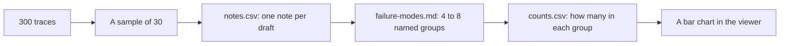

# Look before you measure

## The problem

Lantern Trails has 300 Draft Planner drafts. Designers rewrote or edited about half of them. Nobody knows which drafts were bad, or why. A dashboard score like "4.1 out of 5" would hide the answer. The only way to find out is to read the drafts yourself, write down what you see, and then count.

## Why it matters

Reading the runs is how teams find what the numbers hide. Anthropic reported that one of its own models first scored 42% on a test called CORE-Bench. Then a researcher read the runs and found the grading was broken: it marked "96.12" wrong when it wanted "96.124991". After the fixes, the score was 95%. Anthropic's advice in one line: "Read the transcripts!" ([Anthropic, Demystifying evals for AI agents](https://www.anthropic.com/engineering/demystifying-evals-for-ai-agents))

Hamel Husain and Shreya Shankar, who teach the best-known evals course, give the same order: read first, write free-text notes, then group them. "No quality labels, no dropdowns, no structured forms. Free-text notes only." ([error-discovery skill](https://github.com/ai-evals-course/evals-skills/blob/main/skills/error-discovery/SKILL.md))



## Steps

| Step                                                                  | Minutes | You make                                 | The check reads                                                                            |
| --------------------------------------------------------------------- | ------- | ---------------------------------------- | ------------------------------------------------------------------------------------------ |
| [read-the-traces](01-read-the-traces/problem/README.md)               | 25      | `notes.csv`: a note on each of 30 drafts | Your 30 ids, the length of each note, and whether you caught the drafts with real problems |
| [name-the-failure-modes](02-name-the-failure-modes/problem/README.md) | 20      | `failure-modes.md`: 4 to 8 named groups  | Names, definitions, the drafts in each group, and how many of your notes they cover        |
| [count-the-failures](03-count-the-failures/problem/README.md)         | 10      | `counts.csv`, `top-mode.md` and a chart  | The mode column in `notes.csv`, each count, the sort order and your top mode               |

## Walkthrough

Do the steps in order. Each one checks the files in its own `problem` folder.

```bash
bun run verify read-the-traces
```

Expect: `Done. All 6 rules pass.` once your 30 notes are in `notes.csv`.

```bash
bun run verify name-the-failure-modes
```

Expect: `Done. All 8 rules pass.` once `failure-modes.md` names your groups.

```bash
bun run verify count-the-failures
```

Expect: `Done. All 7 rules pass.` once `counts.csv` and `top-mode.md` are written.

```bash
bun run verify part look-before-you-measure
```

Expect: `Part look-before-you-measure is done: 3/3 steps pass.`
