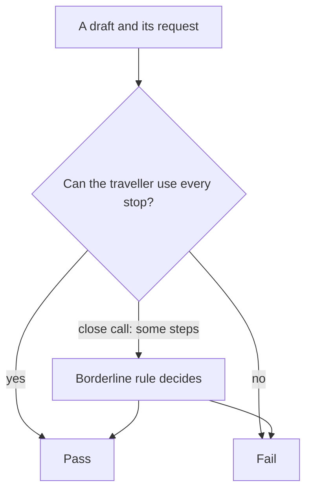

# Write the rubric

## The problem

Your counts showed the top failure: the draft ignores mobility needs. But one designer fails a draft that another designer passes. Every review turns into an argument.

Ines Duarte holds the rule in her head. Put it on paper.

For example, Ines labels these two drafts in `world/data/expert-labels.csv`:

- T149 fails: "Ribeira Hilltop Lanes Walk has steep steps, and the traveller has limited walking."
- T068 passes: "Ribeira Kitchen No. 2 has a few steps, which is fine for limited walking."

Both travellers have limited walking and both places have steps. Say why one passes.



## Your challenge

Open `rubric.md` in this folder. Fill in each part.

1. **Pass**: what a draft that passes looks like. Write what a designer can see, like "every stop is step-free".
2. **Fail**: what a draft that fails looks like.
3. **Borderline rule**: how to decide the close case. Open T068 in the viewer to see it: `world/viewer.html#read/T068`. Look at the `Access:` line of each stop.
4. **Examples**: two drafts that pass and two that fail. Take the ids from `world/data/expert-labels.csv`. Write them like `Pass: T088, T068`.
5. **Does not cover**: one line on what this rubric leaves out, like budget or diet.
6. **Checked by**: one line that starts with Checked by:, then code or judge, then why. Pick code only when a plain rule can see the failure. Write at least 10 words.

Use pass or fail only. Never a score like "4 out of 5". A 4 means something different to each reader.

## Done when

- `rubric.md` has the headings Pass, Fail, Borderline rule and Examples.
- Pass and Fail each say in at least 10 words what to look for.
- The Borderline rule decides the close case in at least 8 words.
- Examples lists at least 2 pass and 2 fail drafts that Ines labelled.
- Every pass example is a draft Ines passed, and every fail example one she failed.
- The rubric has no scale, like 1 to 5, partly or mostly.
- A line that starts with Does not cover says what the rubric leaves out.
- A line that starts with Checked by says code or judge, and why, in at least 10 words.

```bash
bun run verify write-the-rubric
```

Expect: `Done. All 8 rules pass.` and a `Progress:` line.

## If you get stuck

| What you see                                     | Fix                                                                    |
| ------------------------------------------------ | ---------------------------------------------------------------------- |
| `FAIL the Borderline rule decides`               | Say which way some steps go, for limited walking and for a wheelchair. |
| `FAIL Examples lists at least 2 pass and 2`      | Copy ids from `expert-labels.csv`, two on `Pass:` and two on `Fail:`.  |
| `FAIL every pass example is a draft Ines passed` | Check the `label` column for each id. You may have swapped one.        |
| `FAIL the rubric has no scale`                   | Remove words like score, partly and mostly. Ask a yes or no question.  |

## Words you will use

- **Rubric**: a short written rule that says when a draft passes and when it fails.
- **Borderline case**: a draft close to the line, where two careful people could disagree.
- **Scale**: a score from low to high, like 1 to 5.
