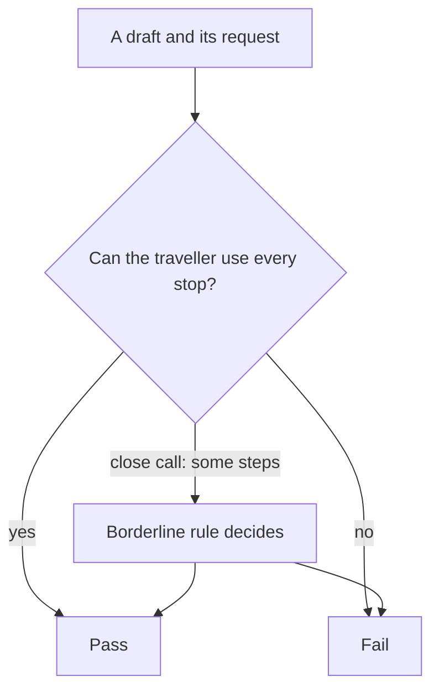

# Write the rubric

## The problem

Your counts showed the top failure: the draft ignores mobility needs. But one designer fails a draft that another designer passes. Every review turns into an argument.

The rule lives in Ines Duarte's head. You need it on paper, so anyone can apply it and get her answer.

For example, Ines labels these two drafts in `world/data/expert-labels.csv`:

- T149 fails: "Ribeira Hilltop Lanes Walk has steep steps, and the traveller has limited walking."
- T068 passes: "Ribeira Kitchen No. 2 has a few steps, which is fine for limited walking."

Both travellers have limited walking. Both places have steps. Your rubric must say why one passes and one fails.



## Your challenge

Open `rubric.md` in this folder. Fill in each part.

1. **Pass**: what a draft that passes looks like. Write what a designer can see, like "every stop is step-free".
2. **Fail**: what a draft that fails looks like.
3. **Borderline rule**: how to decide the close case. Open T068 in the viewer to see it: `world/viewer.html#read/T068`. Look at the `Access:` line of each stop.
4. **Examples**: two drafts that pass and two that fail. Take the ids from `world/data/expert-labels.csv`. Write them like `Pass: T088, T068`.
5. **Does not cover**: one line on what this rubric leaves out, like budget or diet.

Use pass or fail only. Never a score like "4 out of 5". A 4 means something different to each reader, and nobody can build a check from it.

## Done when

- `rubric.md` has the headings Pass, Fail, Borderline rule and Examples.
- Pass and Fail each say in at least 10 words what to look for.
- The Borderline rule decides the close case in at least 8 words.
- Examples lists at least 2 pass and 2 fail drafts that Ines labelled.
- Every pass example is a draft Ines passed, and every fail example one she failed.
- The rubric has no scale: no 1 to 5, no score, no partly or mostly.
- A `Does not cover:` line says what the rubric leaves out.

```bash
bun run verify write-the-rubric
```

Expect: `Done. All 7 rules pass.` and a `Progress:` line.

## If you get stuck

Find your `FAIL` line on the left. Do the fix on the right.

| What you see                                     | Fix                                                                    |
| ------------------------------------------------ | ---------------------------------------------------------------------- |
| `FAIL the Borderline rule decides`               | Say which way some steps go, for limited walking and for a wheelchair. |
| `FAIL Examples lists at least 2 pass and 2`      | Copy ids from `expert-labels.csv`, two on `Pass:` and two on `Fail:`.  |
| `FAIL every pass example is a draft Ines passed` | Check the `label` column for each id. You may have swapped one.        |
| `FAIL the rubric has no scale`                   | Remove words like score, partly and mostly. Ask a yes or no question.  |

## Words you will use

- **Rubric**: a short written rule that says when a draft passes and when it fails.
- **Borderline case**: a draft close to the line, where two careful people could disagree.
- **Step-free**: a place you can reach with no steps, so a wheelchair can get in.
- **Scale**: a score from low to high, like 1 to 5.
