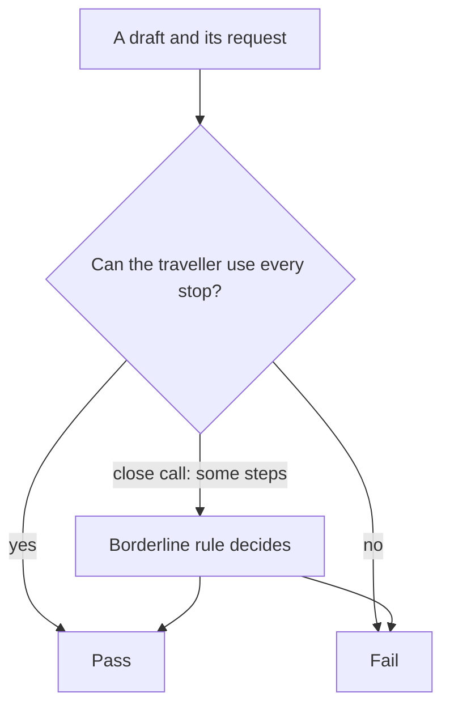

# Write the rubric

## The problem

Ines Duarte holds the rule in her head. For example, draft T149 fails, and draft T068 passes. Both travellers have limited walking, and both places have steps. Every review turns into an argument.

## Watch it done

Before: `rubric.md` has "Write here." under every heading, and the check fails.
After: the four parts are filled in and the check says Done. All 8 rules pass.

## Your turn

1. Look at two drafts in `world/data/expert-labels.csv`:
   - T149 fails: "Ribeira Hilltop Lanes Walk has steep steps, and the traveller has limited walking."
   - T068 passes: "Ribeira Kitchen No. 2 has a few steps, which is fine for limited walking."

   Say why one passes and the other fails.



2. Open `rubric.md` and fill in each part.
   - **Pass**: what a designer can see, like "every stop is step-free".
   - **Fail**: what a draft that fails looks like.
   - **Borderline rule**: how to decide the close case. Open T068 at `world/viewer.html#read/T068`. Read each stop's `Access:` line.
   - **Examples**: two passes and two fails, ids from `world/data/expert-labels.csv`, like Pass: T088, T068.
   - **Does not cover**: one line on what the rubric leaves out.
   - **Checked by**: one line that starts with Checked by:, then code or judge, then why.

Use pass or fail only. Never a score like "4 out of 5".

3. Run the check.

```bash
bun run verify write-the-rubric
```

Expect: `Done. All 8 rules pass.` and a `Progress:` line.

## Do it on your work

Write the same four parts for one rule your own team argues about. Good looks like: a colleague gives the same answer to your Pass and Fail lines.

## Done when

- `rubric.md` has the headings Pass, Fail, Borderline rule and Examples.
- Pass and Fail each say in at least 10 words what to look for.
- The Borderline rule decides the close case in at least 8 words.
- Examples lists at least 2 pass and 2 fail drafts that Ines labelled.
- Every pass example is a draft Ines passed, and every fail example one she failed.
- The rubric has no scale, like 1 to 5, partly or mostly.
- A line that starts with Does not cover says what the rubric leaves out.
- A line that starts with Checked by says code or judge, and why, in at least 10 words.

## Solution

After state: `rubric.md` has all four parts and no scale. The finished file: `solution/rubric.md`.

## If you get stuck

| What you see                                     | Fix                                                                   |
| ------------------------------------------------ | --------------------------------------------------------------------- |
| `FAIL the Borderline rule decides`               | Say which way close cases go, for limited walking and a wheelchair.   |
| `FAIL Examples lists at least 2 pass and 2`      | Copy two ids for Pass: and two for Fail: from `expert-labels.csv`.    |
| `FAIL every pass example is a draft Ines passed` | Check the `label` column. You may have swapped one.                   |
| `FAIL the rubric has no scale`                   | Remove words like score, partly and mostly. Ask a yes or no question. |
