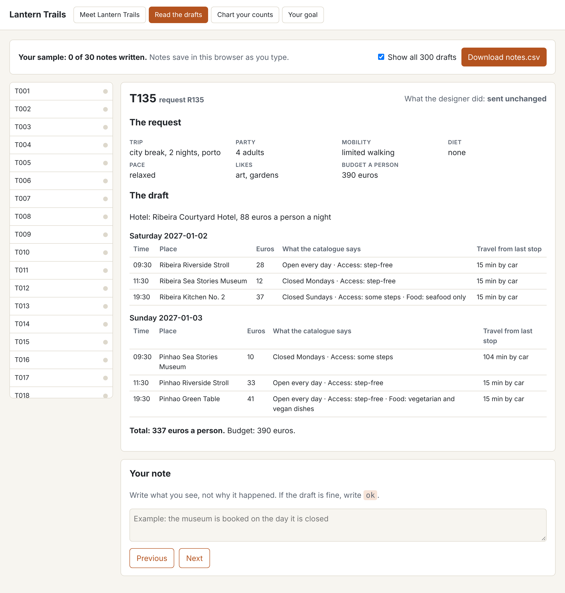

# Label the golden set

## The problem

A rubric on paper is only a guess until you test it. So you label a fixed set of 40 drafts with your rubric.

For example, take draft T135. It is for a traveller with limited walking. One stop says "some steps". Does it pass?

## Watch it done

Before: `labels.csv` has only ids and empty cells, and the check fails.
After: every row has a label, and each fail has a reason. The check says Done. All 5 rules pass.



## Your turn

1. Open `labels.csv` in this folder in a spreadsheet. It lists the 40 ids from `world/data/golden-set.csv`.
2. Keep your rubric open beside it. This folder has a sample `rubric.md`. You can copy your own over it.
3. Open each draft in the viewer. Type its id at the end of the address, like `world/viewer.html#read/T135`.
4. Read the request: does the traveller use a wheelchair, or have limited walking? Then read the `Access:` line of every stop.
5. In the `label` column, type `pass` or `fail`.
6. For each `fail`, write in the `reason` column what you saw. Use at least 6 words. A reason for a pass is welcome, but not needed.
7. Save the file as CSV, in this folder.

Most travellers have no mobility need, so most drafts pass. Expect about 1 in 5 to fail.

Do not look up these 40 ids in `world/data/expert-labels.csv` yet. Label first, then compare in the next step. If you look first, you copy Ines and learn nothing about your rubric.

8. Run the check.

```bash
bun run verify label-the-golden-set
```

Expect: `Done. All 5 rules pass.` and a `Progress:` line.

## Do it on your work

Take a few real drafts from your own product. Label them with the rubric you wrote in the last step. Good looks like: each fail names one stop or step and says what is wrong, and a colleague reaches the same label.

## Done when

- `labels.csv` has the columns `trace_id`, `label` and `reason`.
- It has one row for each of the 40 drafts in `world/data/golden-set.csv`.
- Every label is pass or fail.
- Both pass and fail appear.
- Every fail has a reason of at least 6 words.

## Solution

After state: `labels.csv` has all 40 ids, each labelled pass or fail, and a reason on every fail. The finished file is in `solution/labels.csv`.

## If you get stuck

Find your `FAIL` line on the left. Do the fix on the right.

| What you see                       | Fix                                                                       |
| ---------------------------------- | ------------------------------------------------------------------------- |
| `FAIL it has one row for each`     | Start again from the starter `labels.csv`. Do not add or remove rows.     |
| `FAIL every label is pass or fail` | Fill every empty cell. Change any number or "maybe" to pass or fail.      |
| `FAIL both pass and fail appear`   | Read the drafts with a wheelchair or limited walking again.               |
| `FAIL every fail has a reason`     | Name the stop and say what is wrong, like "steep steps for a wheelchair". |
