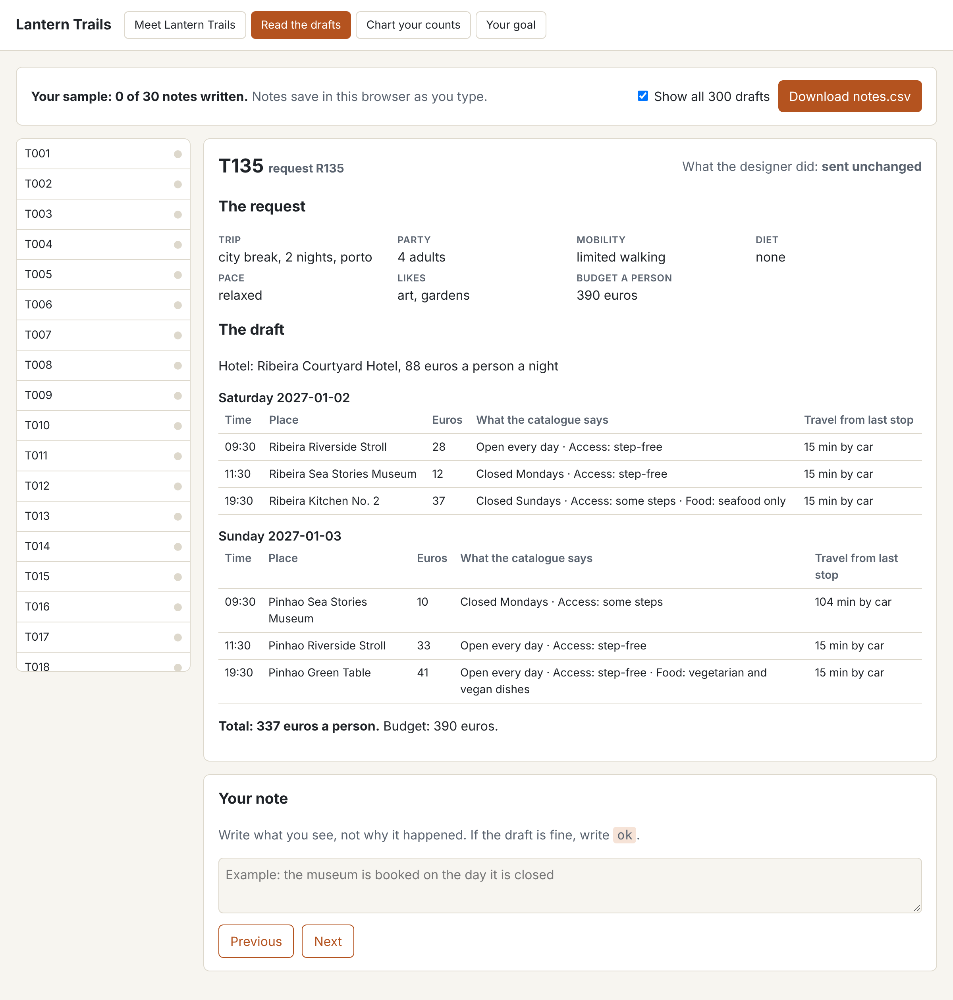

# Label the golden set

## The problem

A rubric on paper is a guess until you use it. You find the gaps only when you apply it to real drafts, one by one.

So you label a fixed set of 40 drafts with your rubric. We call this set the **golden set**. The team tests against the same 40 drafts again and again, so every result can be compared.

For example, draft T135 is for a traveller with limited walking. One stop is "Ribeira Kitchen No. 2". Its `Access:` line says "some steps". Does it pass? Your borderline rule decides.



## Your challenge

1. Open `labels.csv` in this folder in a spreadsheet. It lists the 40 ids from `world/data/golden-set.csv`.
2. Keep your rubric open beside it. This folder has a sample `rubric.md`. You can copy your own over it.
3. Open each draft in the viewer. Type its id at the end of the address, like `world/viewer.html#read/T135`.
4. Read the request: does the traveller use a wheelchair, or have limited walking? Then read the `Access:` line of every stop.
5. In the `label` column, type `pass` or `fail`.
6. For each `fail`, write in the `reason` column what you saw. Use at least 6 words. A reason for a pass is welcome, but not needed.
7. Save the file as CSV, in this folder.

Most travellers have no mobility need, so most drafts pass. Expect about 1 in 5 to fail.

Do not open `world/data/expert-labels.csv` yet. Label first, then compare in the next step. If you look first, you copy Ines and learn nothing about your rubric.

## Done when

- `labels.csv` has the columns `trace_id`, `label` and `reason`.
- It has one row for each of the 40 drafts in `world/data/golden-set.csv`.
- Every label is pass or fail.
- Both pass and fail appear.
- Every fail has a reason of at least 6 words.

```bash
bun run verify label-the-golden-set
```

Expect: `Done. All 5 rules pass.` and a `Progress:` line.

## If you get stuck

Find your `FAIL` line on the left. Do the fix on the right.

| What you see                       | Fix                                                                       |
| ---------------------------------- | ------------------------------------------------------------------------- |
| `FAIL it has one row for each`     | Start again from the starter `labels.csv`. Do not add or remove rows.     |
| `FAIL every label is pass or fail` | Fill every empty cell. Change any number or "maybe" to pass or fail.      |
| `FAIL both pass and fail appear`   | Read the drafts with a wheelchair or limited walking again.               |
| `FAIL every fail has a reason`     | Name the stop and say what is wrong, like "steep steps for a wheelchair". |

## Words you will use

- **Golden set**: a fixed set of drafts with trusted answers. You test against it again and again.
- **Label**: your pass or fail for one draft.
- **Reason**: a short note on why a draft fails. It helps when you compare with Ines.
