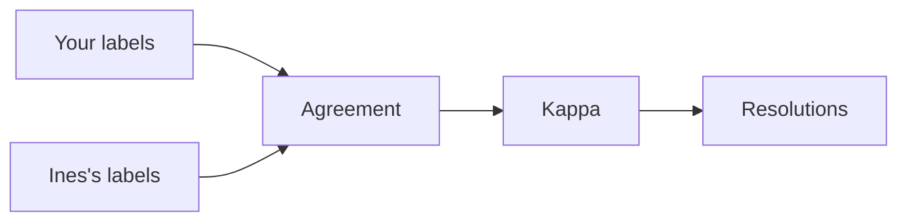

# Compare with the expert

## The problem

You and Ines labelled the same 40 drafts. If your answers match hers, your rubric captures her judgement. For example, you failed T135 and Ines passed it. Her reason: "Ribeira Kitchen No. 2 has a few steps, which is fine for limited walking." Is your label wrong, or is your rubric unclear?

## Watch it done

Before: the check prints `FAIL compare.md states Agreement:` when the number is missing.
After: the check prints `Done. All 6 rules pass.`



## Your turn

1. Put `labels.csv` and `world/data/expert-labels.csv` on two tabs of one spreadsheet. This folder has a sample `labels.csv`. To use yours, copy your `labels.csv` from `label-the-golden-set` over it.
2. Next to each of your labels, look up Ines's label with `VLOOKUP` or `XLOOKUP`.
3. **Agreement**: count the rows where the two labels match. Divide by 40.
4. **Kappa**: first work out the chance of matching by luck.
   - Chance = (your share of pass x Ines's share of pass) + (your share of fail x Ines's share of fail).
   - Kappa = (agreement - chance) / (1 - chance).
5. Write both numbers in `compare.md`, like `Agreement: 0.95` and `Kappa: 0.86`.
6. Under `## Disagreements`, list each draft where you differ, one per line. Pick one resolution for each: keep mine (say why), adopt Ines's, or change the rubric (say what to add).
7. Check the worked example. With the sample labels: chance = (30/40 x 32/40) + (10/40 x 8/40) = 0.65. So kappa = (0.95 - 0.65) / (1 - 0.65) = 0.86.
8. Run the check.

```bash
bun run verify compare-with-the-expert
```

Expect: `Done. All 6 rules pass.` and a `Progress:` line.

## Do it on your work

Pick real cases from your work that two people have judged. Label them yourself, then compare with the other person. Good looks like: `compare.md` has an agreement and a kappa worked out the same way, and one resolution for each disagreement.

## Done when

- labels.csv from the last step is in this folder and passes its check.
- compare.md states Agreement: within 0.01 of the true value.
- compare.md states Kappa: within 0.01 of the true value.
- Every draft where you and Ines differ is listed under ## Disagreements.
- Every draft under ## Disagreements is one where you and Ines differ.
- Each disagreement has one resolution: keep mine, adopt Ines's, or change the rubric.

## Solution

The finished file is `solution/compare.md`. Your `compare.md` holds both numbers and one resolution for each disagreement.

## If you get stuck

| What you see                                 | Fix                                                                     |
| -------------------------------------------- | ----------------------------------------------------------------------- |
| `FAIL compare.md states Agreement:`          | Count same labels and divide by 40. Write it as a decimal or a percent. |
| `FAIL compare.md states Kappa:`              | Work out chance first. Kappa is lower than agreement.                   |
| `FAIL every draft where you and Ines differ` | Filter your sheet to rows where the labels differ. List them all.       |
| `FAIL each disagreement has one resolution`  | Write exactly one of the three choices on each line.                    |
