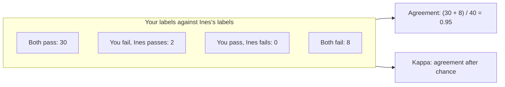

# Compare with the expert

## The problem

You and Ines labelled the same 40 drafts. If your answers match hers, your rubric captures her judgement. Where you differ, you find the gaps.

For example, you failed T135 and Ines passed it. Her reason: "Ribeira Kitchen No. 2 has a few steps, which is fine for limited walking." Is your label wrong, or is your rubric unclear?

## Your challenge

This folder has a sample `labels.csv`. To use your own, copy your `labels.csv` from `label-the-golden-set` over it.

1. Put `labels.csv` and `world/data/expert-labels.csv` on two tabs of one spreadsheet.
2. Next to each of your labels, look up Ines's label with `VLOOKUP` or `XLOOKUP`.
3. **Agreement**: count the rows where the two labels are the same. Divide by 40.
4. **Kappa**: first work out the chance of matching by luck.
   - Chance = (your share of pass x Ines's share of pass) + (your share of fail x Ines's share of fail).
   - Kappa = (agreement - chance) / (1 - chance).
5. Write both numbers in `compare.md`, like `Agreement: 0.95` and `Kappa: 0.86`.
6. Under `## Disagreements`, list each draft where you differ, one per line. Pick one resolution for each:
   - **keep mine**: you still think you are right. Say why.
   - **adopt Ines's**: she is right, and your rubric already says so.
   - **change the rubric**: the rubric did not decide this case. Say what to add.

For example, with the sample labels: chance = (30/40 x 32/40) + (10/40 x 8/40) = 0.65. So kappa = (0.95 - 0.65) / (1 - 0.65) = 0.86.

This is the table you build with the sample labels:



## Done when

- labels.csv from the last step is in this folder and passes its check.
- compare.md states Agreement: within 0.01 of the true value.
- compare.md states Kappa: within 0.01 of the true value.
- Every draft where you and Ines differ is listed under ## Disagreements.
- Every draft under ## Disagreements is one where you and Ines differ.
- Each disagreement has one resolution: keep mine, adopt Ines's, or change the rubric.

```bash
bun run verify compare-with-the-expert
```

Expect: `Done. All 6 rules pass.` and a `Progress:` line.

## If you get stuck

Find your `FAIL` line on the left. Do the fix on the right.

| What you see                                 | Fix                                                               |
| -------------------------------------------- | ----------------------------------------------------------------- |
| `FAIL compare.md states Agreement:`          | Count same labels and divide by 40. Write 0.95 or 95%.            |
| `FAIL compare.md states Kappa:`              | Work out chance first. Kappa is lower than agreement.             |
| `FAIL every draft where you and Ines differ` | Filter your sheet to rows where the labels differ. List them all. |
| `FAIL each disagreement has one resolution`  | Write exactly one of the three choices on each line.              |

## Words you will use

- **Agreement**: the share of drafts where you and Ines give the same label.
- **Chance agreement**: how often two people would match by luck, if they kept their pass and fail shares.
- **Cohen's kappa**: agreement with luck taken out. 1 is a full match. 0 is no better than luck.
- **Resolution**: what you decide to do about one disagreement.
