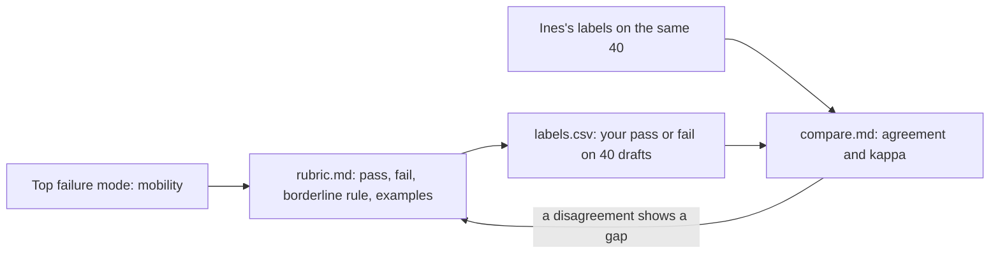

# Define good

Status: TODO(part session). This README is the plan. The step folders do not exist yet.

## The problem

Right now, "good" lives only in Ines Duarte's head. When the team looks at drafts together, people argue. Nobody wrote the rule down.

Your counts in part 1 showed the top failure: the draft ignores mobility needs. Mobility means how well a person can walk or move. Before anyone can measure this failure, someone must say exactly what passes and what fails. Then you check that your rule gives the same answers as Ines.

In this part you write that rule. We call it a **rubric**: a short written rule that says when a draft passes and when it fails.

For example, Ines labels two drafts in `world/data/expert-labels.csv`:

- T015 fails. "Regua Hilltop Lanes Walk has steep steps, and the traveller has limited walking."
- T068 passes. "Ribeira Kitchen No. 2 has a few steps, which is fine for limited walking."

Both travellers have limited walking. Both places have steps. But one passes and one fails. Your rubric must explain why. A case like T068, close to the line, is called a **borderline** case.

## Why it matters

You do not need a big test set to start. Anthropic says this: "20-50 simple tasks drawn from real failures is a great start".

Anthropic also says the rule for success must be clear, so that two people who read it give the same answer. ([Anthropic, Demystifying evals for AI agents](https://www.anthropic.com/engineering/demystifying-evals-for-ai-agents))

This is the path you take in this part:



You label 40 drafts with your rubric. Then you compare your labels with Ines's labels. Two numbers tell you how well you match:

- **Agreement**: the share of drafts where you and Ines give the same answer.
- **Cohen's kappa**: a score for agreement that leaves out the matches you would get by luck. 1 means a full match. 0 means no better than chance.

## Steps

| Step                    | Minutes | You make                                | The check reads                                                                                                                                                                                             |
| ----------------------- | ------- | --------------------------------------- | ----------------------------------------------------------------------------------------------------------------------------------------------------------------------------------------------------------- |
| write-the-rubric        | 20      | `rubric.md` for the mobility mode       | Headings Pass, Fail, Borderline rule, Examples. At least 2 pass and 2 fail examples, each a real trace id. No scale words (1 to 5, partly, mostly). One line on what it does not cover                      |
| label-the-golden-set    | 20      | `labels.csv`: pass or fail on 40 drafts | 40 rows, all ids from `world/data/golden-set.csv`. Every label is pass or fail, and both appear. Each fail has a reason of at least 6 words                                                                 |
| compare-with-the-expert | 10      | `compare.md`                            | Agreement and Cohen's kappa with Ines, each within 0.01 of the true value from `world/data/expert-labels.csv`. Every disagreement listed with one resolution: keep mine, adopt Ines's, or change the rubric |

The data for this part is already in the world:

- `world/data/golden-set.csv`: 40 drafts. 8 of them fail. A **golden set** is a fixed set of drafts with trusted answers that you test against again and again.
- `world/data/expert-labels.csv`: Ines's labels and her reasons.
- The draft view in the viewer.

The borderline case is planted on purpose. Ines passes a traveller with limited walking at a place with "some steps".

## Walkthrough

TODO(part session): write the walkthrough once the steps exist. Each step gets its own command. When all the steps pass, you check the whole part:

```bash
bun run verify part define-good
```

Expect: TODO(part session). Once the steps exist: `Part define-good is done: 3/3 steps pass.`
