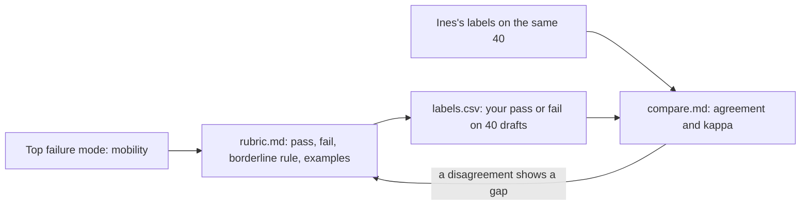

# Define good

## The problem

Right now, "good" lives only in Ines Duarte's head. When the team looks at drafts together, people argue. Nobody wrote the rule down.

Your counts in part 1 showed the top failure: the draft ignores mobility needs. Mobility means how well a person can walk or move. Before anyone can measure this failure, someone must say exactly what passes and what fails. Then you check that your rule gives the same answers as Ines.

In this part you write that rule. We call it a **rubric**: a short written rule that says when a draft passes and when it fails.

For example, Ines labels two drafts in `world/data/expert-labels.csv`:

- T015 fails. "Regua Hilltop Lanes Walk has steep steps, and the traveller has limited walking."
- T068 passes. "Ribeira Kitchen No. 2 has a few steps, which is fine for limited walking."

Both travellers have limited walking. Both places have steps. But one passes and one fails. Your rubric must explain why. A case like T068, close to the line, is called a **borderline** case.

## Why it matters

You do not need a big test set to start. "20-50 simple tasks drawn from real failures is a great start."

Anthropic says this in [Demystifying evals for AI agents](https://www.anthropic.com/engineering/demystifying-evals-for-ai-agents). The same page tells how Descript grades its product. It uses "criteria defined by the product team and periodic human calibration". Calibration here means a person checks that the grades still match their own.

This is the path you take in this part:



You label 40 drafts with your rubric. Then you compare your labels with Ines's labels. Two numbers tell you how well you match:

- **Agreement**: the share of drafts where you and Ines give the same answer.
- **Cohen's kappa**: a score for agreement that leaves out the matches you would get by luck. 1 means a full match. 0 means no better than chance.

## Steps

| Step                                                                    | Minutes | You make                                | The check reads                                                                                    |
| ----------------------------------------------------------------------- | ------- | --------------------------------------- | -------------------------------------------------------------------------------------------------- |
| [write-the-rubric](01-write-the-rubric/problem/README.md)               | 20      | `rubric.md` for the mobility mode       | The four headings, the borderline rule, 2 pass and 2 fail examples that match Ines, no scale words |
| [label-the-golden-set](02-label-the-golden-set/problem/README.md)       | 20      | `labels.csv`: pass or fail on 40 drafts | The 40 ids of `world/data/golden-set.csv`, pass or fail on each, a reason on each fail             |
| [compare-with-the-expert](03-compare-with-the-expert/problem/README.md) | 10      | `compare.md`                            | Agreement and kappa against `world/data/expert-labels.csv`, and a resolution on every disagreement |

The data for this part is already in the world:

- `world/data/golden-set.csv`: 40 drafts. 8 of them fail. A **golden set** is a fixed set of drafts with trusted answers that you test against again and again.
- `world/data/expert-labels.csv`: Ines's labels and her reasons, for 120 drafts.
- The viewer: `world/viewer.html#read/T068` opens any draft by its id.

The borderline case is planted on purpose. Ines passes a traveller with limited walking at a place with "some steps".

## Walkthrough

Do the steps in order. Each step checks the files in its own `problem` folder. Each starter already holds the sample answer from the step before, so you can start any step.

```bash
bun run verify write-the-rubric
```

Expect: `Done. All 7 rules pass.` once `rubric.md` has its four parts, its examples and no scale.

```bash
bun run verify label-the-golden-set
```

Expect: `Done. All 5 rules pass.` once all 40 drafts in `labels.csv` have a label.

```bash
bun run verify compare-with-the-expert
```

Expect: `Done. All 6 rules pass.` once `compare.md` has the two numbers and a resolution for each disagreement.

When all three steps pass, check the whole part:

```bash
bun run verify part define-good
```

Expect: `Part define-good is done: 3/3 steps pass.`

## Assignment

The problem: "good" lives in Ines's head, so reviews turn into arguments.

Hand in the three files from this part: `rubric.md`, `labels.csv` and `compare.md`. The steps above check them. In a cohort, a grader also asks these yes or no questions:

| #   | Question                                                                            | Check                     |
| --- | ----------------------------------------------------------------------------------- | ------------------------- |
| 1   | Does the rubric have Pass, Fail, Borderline rule and Examples, with no scale words? | `write-the-rubric`        |
| 2   | Are all 40 golden drafts labelled pass or fail, with a reason on every fail?        | `label-the-golden-set`    |
| 3   | Are the stated agreement and kappa within 0.01 of the true values?                  | `compare-with-the-expert` |
| 4   | Does every disagreement have one resolution?                                        | `compare-with-the-expert` |

Four yes answers is a pass. In a cohort, question 3 is run again on 40 private labels from Ines, so copying her file does not help.

Extension: write a second rubric for "wrong pace". Add one line on why pace is harder to make pass or fail than mobility.

## Finished

You now have a written rule for the top failure mode. You tested it on 40 drafts and know how close it comes to Ines. For example, the sample answer agrees with her on 38 of 40 drafts, with a kappa of 0.86.

Your labels cannot scale. Nobody reads every draft by hand forever. In the next part, [check the judge](../03-check-the-judge/README.md), an AI model grades the drafts. You use Ines's labels to test whether that grader can be trusted.
