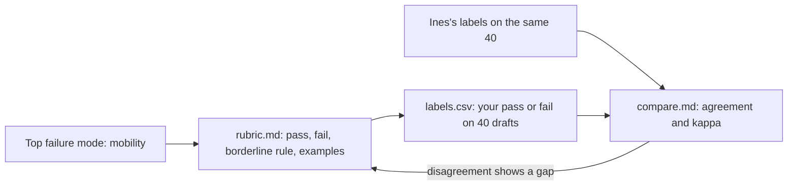

# Define good

Status: TODO(part session). This README is the plan. The step folders do not exist yet.

## The problem

"Good" lives in Ines Duarte's head. When the team reviews drafts, people argue, because nobody wrote the rule down. Your counts showed that ignoring mobility needs is the top failure. Before anyone can measure it, someone must say exactly what passes and what fails. Then you check that your rule matches Ines.

## Why it matters

Anthropic says a small, sharp set is enough to start: "20-50 simple tasks drawn from real failures is a great start." It also says to "define unambiguous, robust success criteria". ([Anthropic, Demystifying evals for AI agents](https://www.anthropic.com/engineering/demystifying-evals-for-ai-agents))



## Steps

| Step                    | Minutes | You make                                | The check reads                                                                                                                                                                                             |
| ----------------------- | ------- | --------------------------------------- | ----------------------------------------------------------------------------------------------------------------------------------------------------------------------------------------------------------- |
| write-the-rubric        | 20      | `rubric.md` for the mobility mode       | Headings Pass, Fail, Borderline rule, Examples. At least 2 pass and 2 fail examples, each a real trace id. No scale words (1 to 5, partly, mostly). One line on what it does not cover                      |
| label-the-golden-set    | 20      | `labels.csv`: pass or fail on 40 drafts | 40 rows, all ids from `world/data/golden-set.csv`. Every label is pass or fail, and both appear. Each fail has a reason of at least 6 words                                                                 |
| compare-with-the-expert | 10      | `compare.md`                            | Agreement and Cohen's kappa with Ines, each within 0.01 of the true value from `world/data/expert-labels.csv`. Every disagreement listed with one resolution: keep mine, adopt Ines's, or change the rubric |

Data this part uses, already in the world: `world/data/golden-set.csv` (40 drafts, 8 fail), `world/data/expert-labels.csv` (Ines's labels and critiques), and the viewer's draft view. The borderline case is planted: travellers with limited walking and a place with "some steps" pass for Ines.

## Walkthrough

TODO(part session): write the walkthrough once the steps exist. Each step gets its own command:

```bash
bun run verify part define-good
```

Expect: TODO(part session). Once the steps exist: `Part define-good is done: 3/3 steps pass.`
