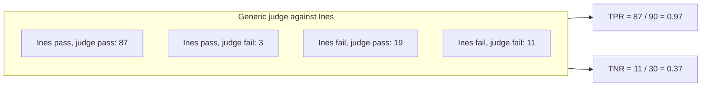

# Test the judge

## The problem

The engineers put an AI judge on a dashboard. It says most drafts pass. Before anyone quotes that number, you must check it against Ines, who labelled 120 drafts. The generic judge passes 106 of them. Ines passes only 90. So it must miss some real fails.

## Watch it done

Before: `judge-check.md` has no rates yet, so the check does not pass.
After: the check says Done. All 5 rules pass.

## Your turn

1. Put `world/data/expert-labels.csv` and each file in `world/data/judges/` on its own tab of one spreadsheet. The generic judge file is `world/data/judges/judge-generic-pass-fail.csv`.
2. On each judge tab, add a column with Ines's label for the same `trace_id`. Use `VLOOKUP` or `XLOOKUP`.
3. Count the four boxes with `COUNTIFS`. For example: Ines says pass and the judge says pass.
4. Work out two numbers for each pass or fail judge:
   - **TPR** = drafts both passed / drafts Ines passed.
   - **TNR** = drafts both failed / drafts Ines failed.
5. Write them in `judge-check.md`, under each judge's heading, like `TPR: 0.97`.
6. On the `Pick:` line, name the judge you trust. Both its rates must be 0.80 or more.
7. Under the 1 to 5 judge, say why you cannot work out its TPR and TNR yet.
8. Run the check.

```bash
bun run verify test-the-judge
```

Expect: `Done. All 5 rules pass.` and a `Progress:` line.

## Do it on your work

Pick one yes or no check you already use, such as a spam filter. Label a few cases yourself, then count the four boxes. Good looks like: you have a TPR and TNR for that check, and a view on trusting it.

## Done when

- judge-check.md has a section for the generic, mobility and 1 to 5 judges.
- The generic judge's TPR and TNR are each within 0.01 of the true values.
- The mobility judge's TPR and TNR are each within 0.01 of the true values.
- Pick: names the mobility judge, the only one with both rates at 0.80 or more.
- The 1 to 5 section says in 8 or more words why it cannot be checked without a pass line.

## Solution

The `solution` folder holds a finished `judge-check.md`. Its Pick line names the mobility judge.

## If you get stuck

Find your `FAIL` line on the left. Do the fix on the right.

| What you see                            | Fix                                                                    |
| --------------------------------------- | ---------------------------------------------------------------------- |
| `FAIL the generic judge's TPR and TNR`  | Divide by what Ines said, not by what the judge said.                  |
| `FAIL the mobility judge's TPR and TNR` | Check you did not swap them. TPR is about the drafts Ines passed.      |
| `FAIL Pick: names the mobility judge`   | Look at the lower rate of each judge. Pick the one at 0.80 or more.    |
| `FAIL the 1 to 5 section says`          | Ines gives pass or fail. Say what you need to turn a score into those. |

## Words you will use

- **Pass line**: the score where a scale turns into pass, like "4 or more passes".

## The table for one judge



A judge that passes everything has a TPR of 1.00, and catches no failures.
