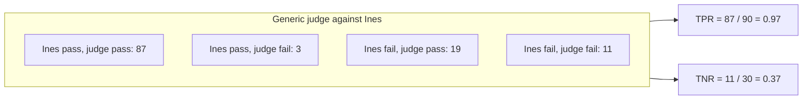

# Test the judge

## The problem

The engineers put an AI judge on a dashboard. It says most drafts pass. Before anyone quotes that number at a launch meeting, you must check the judge against Ines.

Three judges graded the 120 drafts Ines labelled. Which one can you trust?

For example, Ines fails T008: "Belem Hilltop Lanes Walk has steep steps, and the traveller uses a wheelchair." Open `world/data/judges/judge-generic-pass-fail.csv`. That judge fails T008 too. But it passes 106 of the 120 drafts, and Ines passes only 90. So it must miss some of her fails.

## Your challenge

1. Put `world/data/expert-labels.csv` and each file in `world/data/judges/` on its own tab of one spreadsheet.
2. On each judge tab, add a column with Ines's label for the same `trace_id`. Use `VLOOKUP` or `XLOOKUP`.
3. Count the four boxes with `COUNTIFS`. For example: Ines says pass and the judge says pass.
4. Work out two numbers for each pass or fail judge:
   - **TPR** = drafts both passed / drafts Ines passed.
   - **TNR** = drafts both failed / drafts Ines failed.
5. Write them in `judge-check.md`, under each judge's heading, like `TPR: 0.97`.
6. On the `Pick:` line, name the judge you trust. Both its rates must be 0.80 or more.
7. Under the 1 to 5 judge, say why you cannot work out its TPR and TNR yet.

A judge that passes everything has a TPR of 1.00, and catches no failures.

Here is the table you build for each judge, with the generic judge's counts:



## Done when

- judge-check.md has a section for the generic, mobility and 1 to 5 judges.
- The generic judge's TPR and TNR are each within 0.01 of the true values.
- The mobility judge's TPR and TNR are each within 0.01 of the true values.
- Pick: names the mobility judge, the only one with both rates at 0.80 or more.
- The 1 to 5 section says in 8 or more words why it cannot be checked without a pass line.

```bash
bun run verify test-the-judge
```

Expect: `Done. All 5 rules pass.` and a `Progress:` line.

## If you get stuck

Find your `FAIL` line on the left. Do the fix on the right.

| What you see                            | Fix                                                                    |
| --------------------------------------- | ---------------------------------------------------------------------- |
| `FAIL the generic judge's TPR and TNR`  | Divide by what Ines said, not by what the judge said.                  |
| `FAIL the mobility judge's TPR and TNR` | Check you did not swap them. TPR is about the drafts Ines passed.      |
| `FAIL Pick: names the mobility judge`   | Look at the lower rate of each judge. Pick the one at 0.80 or more.    |
| `FAIL the 1 to 5 section says`          | Ines gives pass or fail. Say what you need to turn a score into those. |

## Words you will use

- **TPR** (true positive rate): of the drafts Ines passed, the share the judge also passed.
- **TNR** (true negative rate): of the drafts Ines failed, the share the judge also failed.
- **Pass line**: the score where a scale turns into pass, like "4 or more passes".
