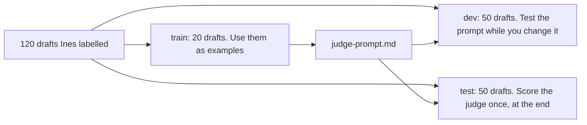

# Choose the judge prompt

## The problem

The mobility judge passed your test. Now you write down its prompt, so anyone can see what it holds.

A **prompt** is the text you give an AI model to tell it what to do. A judge prompt holds your rubric, a few worked examples, and the shape of the answer.

For example, T068 looks like a perfect example for the borderline rule. But T068 is in `world/data/splits/test.csv`. If the judge sees it in its prompt, the test score on T068 is no longer a real test. This is called **leakage**.

## Your challenge

This folder has a sample `rubric.md`. You can copy your own rubric over it.

Open `judge-prompt.md` and fill in each part:

1. **The first line**: tell the judge its one job. It checks mobility only, nothing else.
2. **Pass** and **Fail**: paste the text from `rubric.md`, word for word. If the words change, the judge grades by a different rule than Ines.
3. **Examples**: 2 to 4 drafts from `world/data/splits/train.csv`. Include at least one Ines passed and one she failed. Write each one with her label and reason, like `- T056: fail. Foz Hilltop Lanes Walk has steep steps.`
4. **Output**: ask for the critique first, then the verdict, pass or fail. When the judge writes its reason first, its verdict follows from the reason.

Leave out every other failure mode. A judge that checks budget, diet and mobility at once mixes them up. One judge checks one mode.

Here is why the examples must come from train:



## Done when

- judge-prompt.md and rubric.md are in this folder.
- The prompt holds the Pass and Fail text of rubric.md, word for word.
- The ## Examples section has 2 to 4 drafts.
- Every example comes from world/data/splits/train.csv.
- The examples show at least one pass and one fail from Ines.
- The ## Output section asks for the reason before the verdict.
- The prompt checks mobility only, and names no other failure mode.

```bash
bun run verify choose-the-judge-prompt
```

Expect: `Done. All 7 rules pass.` and a `Progress:` line.

## If you get stuck

Find your `FAIL` line on the left. Do the fix on the right.

| What you see                                     | Fix                                                              |
| ------------------------------------------------ | ---------------------------------------------------------------- |
| `FAIL the prompt holds the Pass and Fail text`   | Copy and paste from `rubric.md`. Do not retype it.               |
| `FAIL every example comes from`                  | Search for each id in `splits/train.csv`. Swap any id not there. |
| `FAIL the ## Output section asks for the reason` | Put the word critique before the word verdict.                   |
| `FAIL the prompt checks mobility only`           | Remove lines about budget, diet, pace, closed days or seasons.   |

## Words you will use

- **Prompt**: the text you give an AI model to tell it what to do.
- **Train, dev and test**: three groups of labelled drafts. Train gives examples. Dev is for trying changes. Test gives the final score.
- **Leakage**: a test draft that got into the prompt. Then the test score looks better than it really is.
- **Critique**: the judge's short reason, written before its verdict.
