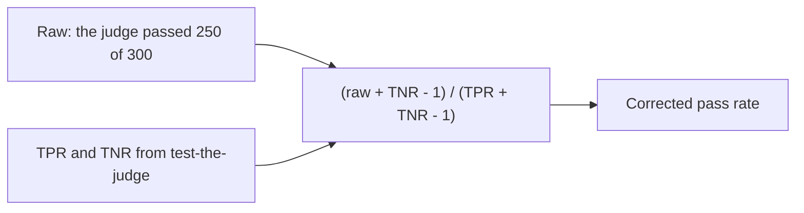

# Correct the pass rate

This is an extension step. You can skip it.

## The problem

The mobility judge ran on all 300 drafts. It passed 250 of them, so the dashboard says 83% pass on mobility. But you know the judge is not perfect. It fails some good drafts and passes some bad ones. So 83% is not the true rate.

You can fix the number with the two rates you found in `test-the-judge`. The fix is called the **Rogan-Gladen correction**.

For example, Hamel Husain and Shreya Shankar give this case in their [validate-evaluator skill](https://github.com/ai-evals-course/evals-skills/blob/main/skills/validate-evaluator/SKILL.md). A judge has TPR 0.92 and TNR 0.88. It passes 400 of 500 traces, so 0.80. The corrected rate is (0.80 + 0.88 - 1) / (0.92 + 0.88 - 1) = 0.68 / 0.80 = 0.85.

## Your challenge

1. Open `corrected.md` in this folder.
2. Write the raw rate: 250 divided by 300. For example, `Raw pass rate: 0.833`.
3. Copy the mobility judge's `TPR:` and `TNR:` from your `judge-check.md`.
4. In a spreadsheet cell, work out the corrected rate:
   - corrected = (raw + TNR - 1) / (TPR + TNR - 1)
5. Write it on the `Corrected pass rate:` line.
6. On the `Why:` line, say in one sentence why the raw rate is wrong.

Keep three decimal places while you work. Round only at the end.

This is how the correction works:



## Done when

- corrected.md states the Raw pass rate: of the judge, 250 of 300.
- The TPR: and TNR: lines hold the mobility judge's rates from test-the-judge.
- The Corrected pass rate: is within 0.01 of the Rogan-Gladen value.
- A Why: line says in 8 or more words why the raw rate is wrong.

```bash
bun run verify correct-the-pass-rate
```

Expect: `Done. All 4 rules pass.` and a `Progress:` line.

## If you get stuck

Find your `FAIL` line on the left. Do the fix on the right.

| What you see                        | Fix                                                         |
| ----------------------------------- | ----------------------------------------------------------- |
| `FAIL the TPR: and TNR: lines hold` | Use the mobility judge, not the generic one.                |
| `FAIL the Corrected pass rate: is`  | Check the brackets. Both the top and the bottom subtract 1. |
| `FAIL a Why: line says`             | Say what the judge gets wrong, in a full sentence.          |

## Words you will use

- **Raw pass rate**: the share of drafts the judge passed, before any fix.
- **Corrected pass rate**: the share that would pass if the judge made no mistakes.
- **Rogan-Gladen correction**: the formula that turns the raw rate into the corrected rate, using TPR and TNR.
