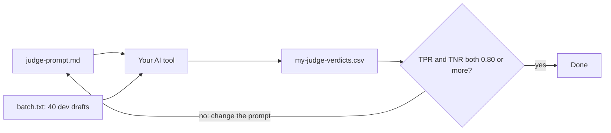

# Write your own judge

This is an extension step. You can skip it.

## The problem

So far you tested judges that the engineers built. Now you build one yourself, with the prompt from `choose-the-judge-prompt`. Then you test it the same way: against Ines.

You may use any AI tool you like. The check never sees your tool. It reads only the file you hand in, so the file is the contract.

For example, one row of a good answer looks like this:

```text
T071,"Faro Hilltop Lanes Walk has steep steps, and the traveller uses a wheelchair.",fail
```

Ines also fails T071, so the judge got this one right.

## Your challenge

1. Open `batch.txt` in this folder. It holds the 40 drafts to judge, one after the other. They all come from `world/data/splits/dev.csv`.
2. Open an AI chat tool, like Claude Desktop. Paste your `judge-prompt.md` from the last step.
3. Then paste `batch.txt`. Ask for one line per draft, in this shape: `trace_id,critique,verdict`.
4. Copy the answer into `my-judge-verdicts.csv` in this folder. Keep the first row as it is.
5. Run the check. It works out your judge's TPR and TNR against Ines.
6. If a rate is under 0.80, change the prompt and run the batch again. Look at the drafts where the judge and Ines differ. Change one thing at a time.

Other tools work too. In Google Sheets, an AI function filled down a column gives the same CSV. Langfuse and Braintrust can also run a judge and export its scores.

Do not change a verdict by hand. Then you test yourself, not the judge.

This is the loop you run:



## Done when

- my-judge-verdicts.csv has the columns trace_id, critique, verdict, in that order.
- It has 40 rows, each a different draft from world/data/splits/dev.csv.
- Every verdict is pass or fail.
- Every critique has at least 6 words.
- TPR against Ines is 0.80 or more.
- TNR against Ines is 0.80 or more.

```bash
bun run verify write-your-own-judge
```

Expect: `Done. All 6 rules pass.` and a `Progress:` line.

## If you get stuck

Find your `FAIL` line on the left. Do the fix on the right.

| What you see                         | Fix                                                                     |
| ------------------------------------ | ----------------------------------------------------------------------- |
| `FAIL my-judge-verdicts.csv has the` | Put the critique before the verdict, in every row and in the header.    |
| `FAIL it has 40 rows`                | Ask the tool for all 40 drafts. Some tools stop early; ask it to go on. |
| `FAIL TPR against Ines`              | The judge fails good drafts. Add a pass example from train.             |
| `FAIL TNR against Ines`              | The judge passes bad drafts. Make the Fail text plainer.                |

## Words you will use

- **Contract**: the exact shape of the file you hand in. Any tool that makes that shape passes.
- **Batch**: many drafts sent to the judge at once.
- **Dev split**: the drafts you use to try changes to the prompt.
