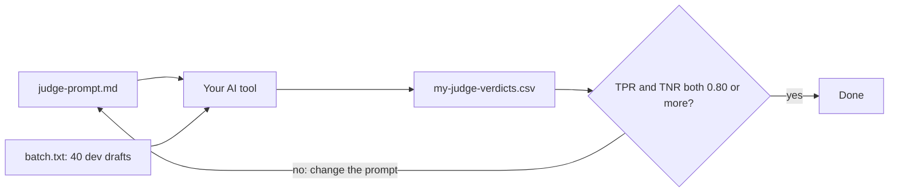

# Write your own judge

This is an extension step. You can skip it.

## The problem

So far you tested judges the engineers built. Now build one yourself, with the prompt from `choose-the-judge-prompt`. Then test it the same way, against Ines. The check reads only the file you hand in. For example, Ines fails T071, so a judge that also fails it gets that draft right.

## Watch it done

Before: `my-judge-verdicts.csv` is not finished, so the check does not pass.
After: the check says Done. All 6 rules pass.

One row of a good answer looks like this:

```text
T071,"Faro Hilltop Lanes Walk has steep steps, and the traveller uses a wheelchair.",fail
```

## Your turn

1. Open `batch.txt` in this folder. It holds the 40 drafts to judge, one after the other. They all come from `world/data/splits/dev.csv`.
2. Open an AI chat tool, like Claude Desktop. Paste your `judge-prompt.md` from the `choose-the-judge-prompt` step.
3. Then paste `batch.txt`. Ask for one line per draft, in this shape: `trace_id,critique,verdict`.
4. Copy the answer into `my-judge-verdicts.csv` in this folder. Keep the first row as it is.
5. Run the check. It works out your judge's TPR and TNR against Ines.

```bash
bun run verify write-your-own-judge
```

Expect: `Done. All 6 rules pass.` and a `Progress:` line.

6. If a rate is under 0.80, change the prompt and run the batch again. Look at the drafts where the judge and Ines differ. Change one thing at a time.

Other tools work too. In Google Sheets, an AI function filled down a column gives the same CSV. Langfuse and Braintrust can also run a judge and export its scores. Do not change a verdict by hand. Then you test yourself, not the judge.

## Do it on your work

Pick a yes or no check you run at work, such as a grader for your own drafts. Label a few cases yourself. Run the same loop and write the verdicts. Good looks like: your judge's TPR and TNR are both 0.80 or more on your own labels.

## Done when

- my-judge-verdicts.csv has the columns trace_id, critique, verdict, in that order.
- It has 40 rows, each a different draft from world/data/splits/dev.csv.
- Every verdict is pass or fail.
- Every critique has at least 6 words.
- TPR against Ines is 0.80 or more.
- TNR against Ines is 0.80 or more.

## Solution

The `solution` folder holds a finished `my-judge-verdicts.csv` that passes the check.

## If you get stuck

Find your `FAIL` line on the left. Do the fix on the right.

| What you see                         | Fix                                                                     |
| ------------------------------------ | ----------------------------------------------------------------------- |
| `FAIL my-judge-verdicts.csv has the` | Put the critique before the verdict, in every row and in the header.    |
| `FAIL it has 40 rows`                | Ask the tool for all 40 drafts. Some tools stop early; ask it to go on. |
| `FAIL TPR against Ines`              | The judge fails good drafts. Add a pass example from train.             |
| `FAIL TNR against Ines`              | The judge passes bad drafts. Make the Fail text plainer.                |

## Words you will use

- **Contract**: the exact shape of the file you hand in. Any tool that makes that shape passes.

## The loop you run


