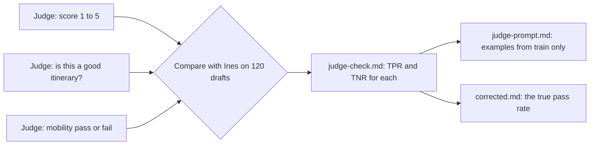

# Check the judge

Status: TODO(part session). This README is the plan. The step folders do not exist yet.

## The problem

You cannot read every draft by hand forever. So teams use an AI model to grade the drafts. We call this AI grader a **judge**. A judge reads a draft and says pass or fail.

The engineers added a judge to a dashboard. It says most drafts pass. Before anyone quotes that number in a launch meeting, someone must check the judge against Ines.

Three judges ran on the same 120 drafts. Only one of them is good enough to trust.

For example, look at draft T015. Ines says it fails: the "Regua Hilltop Lanes Walk" has steep steps, and the traveller has limited walking. Here is what each judge says about T015:

- The general judge says pass: "This is a good itinerary." (An itinerary is a trip plan.)
- The mobility judge says fail: "A stop on this trip is not step-free for this traveller."
- The 1 to 5 judge gives it a 4. But a 4 is not a pass or a fail, so you cannot check it against Ines.

The general judge misses many failures like this one. It passes 106 of the 120 drafts. Ines passes only 90.

## Why it matters

Anthropic writes that "LLM-as-judge graders should be closely calibrated with human experts". ([Anthropic, Demystifying evals for AI agents](https://www.anthropic.com/engineering/demystifying-evals-for-ai-agents)) In plain words: an AI judge must give the same answers as a human expert, or you cannot trust it.

Hamel Husain and Shreya Shankar give two numbers to check a judge:

- **TPR** (true positive rate): of the drafts Ines passes, the share the judge also passes.
- **TNR** (true negative rate): of the drafts Ines fails, the share the judge also fails.

Both should be above 90%, and never below 80%. A judge that is a bit off gives you the wrong pass rate. In their worked example, a judge has a TPR of 0.92 and a TNR of 0.88. It reports an 80% pass rate. The true pass rate is about 85%. ([validate-evaluator skill](https://github.com/ai-evals-course/evals-skills/blob/main/skills/validate-evaluator/SKILL.md))

This is the path you take in this part:



## Steps

| Step                              | Minutes | You make                | The check reads                                                                                                                                                                                                                                                                                        |
| --------------------------------- | ------- | ----------------------- | ------------------------------------------------------------------------------------------------------------------------------------------------------------------------------------------------------------------------------------------------------------------------------------------------------ |
| test-the-judge                    | 25      | `judge-check.md`        | TPR and TNR for the two pass or fail judges, each within 0.01 of the values from `world/data/judges/` against `world/data/expert-labels.csv`. The pick is the judge whose lower value is at least 0.80 (only the mobility judge). One line on why a 1 to 5 score cannot be checked without a pass line |
| choose-the-judge-prompt           | 20      | `judge-prompt.md`       | The Pass and Fail text from the rubric. 2 to 4 examples, all from `world/data/splits/train.csv` (an id from dev or test is leakage and fails). Asks for a reason before the verdict. Covers one failure mode only                                                                                      |
| correct-the-pass-rate (extension) | 15      | `corrected.md`          | The corrected pass rate with the Rogan-Gladen formula, within 0.01. One line on why the raw rate is wrong                                                                                                                                                                                              |
| write-your-own-judge (extension)  | 20      | `my-judge-verdicts.csv` | Columns trace_id, critique, verdict. 40 rows from `world/data/splits/dev.csv`. TPR and TNR against Ines both at least 0.80. Any tool may make it; the file is the contract                                                                                                                             |

A few more words from the table:

- A **prompt** is the text you give an AI model to tell it what to do.
- **Leakage** means the judge saw a test draft while you built it. Then its test score looks better than it really is.
- An **extension** is an extra step. You can skip it.

The numbers are already planted in the world. The mobility judge gets TPR 84 of 90 and TNR 26 of 30. The general judge gets TPR 87 of 90 but TNR only 11 of 30. The file `tests/world.test.ts` makes sure these numbers do not change.

## Walkthrough

TODO(part session): write the walkthrough once the steps exist. When all the steps pass, you check the whole part:

```bash
bun run verify part check-the-judge
```

Expect: TODO(part session). Once the steps exist: `Part check-the-judge is done: 4/4 steps pass.`
