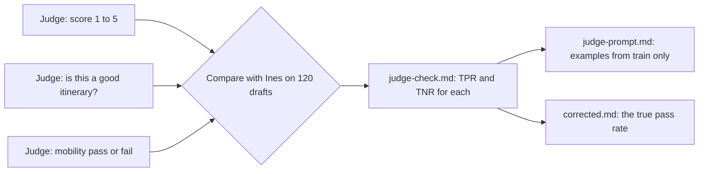

# Check the judge

Status: TODO(part session). This README is the plan. The step folders do not exist yet.

## The problem

Engineering wired an AI grader, called a judge, into a dashboard. It says most drafts pass. Before anyone quotes that number in a launch review, someone has to check the judge against Ines. Three judges were run on the same 120 drafts. Only one of them can be trusted.

## Why it matters

Anthropic writes that "LLM-as-judge graders should be closely calibrated with human experts". ([Anthropic, Demystifying evals for AI agents](https://www.anthropic.com/engineering/demystifying-evals-for-ai-agents)) Hamel Husain and Shreya Shankar give the bar: a judge should agree with the expert on passes (TPR) and on fails (TNR) above 90%, and never below 80%. In their worked example, a judge with TPR 0.92 and TNR 0.88 reports an 80% pass rate when the true rate is about 85%. ([validate-evaluator skill](https://github.com/ai-evals-course/evals-skills/blob/main/skills/validate-evaluator/SKILL.md))



## Steps

| Step                              | Minutes | You make                | The check reads                                                                                                                                                                                                                                                                                        |
| --------------------------------- | ------- | ----------------------- | ------------------------------------------------------------------------------------------------------------------------------------------------------------------------------------------------------------------------------------------------------------------------------------------------------ |
| test-the-judge                    | 25      | `judge-check.md`        | TPR and TNR for the two pass or fail judges, each within 0.01 of the values from `world/data/judges/` against `world/data/expert-labels.csv`. The pick is the judge whose lower value is at least 0.80 (only the mobility judge). One line on why a 1 to 5 score cannot be checked without a pass line |
| choose-the-judge-prompt           | 20      | `judge-prompt.md`       | The Pass and Fail text from the rubric. 2 to 4 examples, all from `world/data/splits/train.csv` (an id from dev or test is leakage and fails). Asks for a reason before the verdict. Covers one failure mode only                                                                                      |
| correct-the-pass-rate (extension) | 15      | `corrected.md`          | The corrected pass rate with the Rogan-Gladen formula, within 0.01. One line on why the raw rate is wrong                                                                                                                                                                                              |
| write-your-own-judge (extension)  | 20      | `my-judge-verdicts.csv` | Columns trace_id, critique, verdict. 40 rows from `world/data/splits/dev.csv`. TPR and TNR against Ines both at least 0.80. Any tool may make it; the file is the contract                                                                                                                             |

Planted numbers, already in the world: mobility judge TPR 84 of 90 and TNR 26 of 30; generic judge TPR 87 of 90 and TNR 11 of 30. `tests/world.test.ts` guards them.

## Walkthrough

TODO(part session): write the walkthrough once the steps exist.

```bash
bun run verify part check-the-judge
```

Expect: TODO(part session). Once the steps exist: `Part check-the-judge is done: 4/4 steps pass.`
