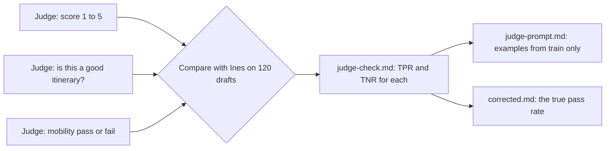

# Check the judge

## The problem

You cannot read every draft by hand forever. So teams use an AI model to grade the drafts. We call this AI grader a **judge**. A judge reads a draft and says pass or fail.

The engineers added a judge to a dashboard. It says most drafts pass. Before anyone quotes that number in a launch meeting, someone must check the judge against Ines.

Three judges ran on the same 120 drafts. Only one of them is good enough to trust.

For example, look at draft T015. Ines says it fails: the "Regua Hilltop Lanes Walk" has steep steps, and the traveller has limited walking. Here is what each judge says about T015:

- The generic judge says pass: "This is a good itinerary." (An itinerary is a trip plan. The generic judge asks only if the trip is good, not about one kind of mistake.)
- The mobility judge says fail: "A stop on this trip is not step-free for this traveller."
- The 1 to 5 judge gives it a 4. But a 4 is not a pass or a fail, so you cannot check it against Ines.

The generic judge misses many failures like this one. It passes 106 of the 120 drafts. Ines passes only 90.

## Why it matters

Anthropic writes that "LLM-as-judge graders should be closely calibrated with human experts". ([Anthropic, Demystifying evals for AI agents](https://www.anthropic.com/engineering/demystifying-evals-for-ai-agents)) In plain words: an AI judge must give the same answers as a human expert, or you cannot trust it.

Hamel Husain and Shreya Shankar give two numbers to check a judge:

- **TPR** (true positive rate): of the drafts Ines passes, the share the judge also passes.
- **TNR** (true negative rate): of the drafts Ines fails, the share the judge also fails.

They aim for both above 90%. The lowest they accept is above 80%. A judge that is a bit off gives you the wrong pass rate. In their worked example, a judge has a TPR of 0.92 and a TNR of 0.88. It reports an 80% pass rate. The true pass rate is about 85%. ([validate-evaluator skill](https://github.com/ai-evals-course/evals-skills/blob/main/skills/validate-evaluator/SKILL.md))

This is the path you take in this part:



## Steps

| Step                                                                            | Minutes | You make                | The check reads                                                                                                |
| ------------------------------------------------------------------------------- | ------- | ----------------------- | -------------------------------------------------------------------------------------------------------------- |
| [test-the-judge](01-test-the-judge/problem/README.md)                           | 25      | `judge-check.md`        | TPR and TNR of the two pass or fail judges against Ines, your pick, and why a 1 to 5 score cannot be checked   |
| [choose-the-judge-prompt](02-choose-the-judge-prompt/problem/README.md)         | 20      | `judge-prompt.md`       | The rubric's Pass and Fail text, 2 to 4 examples from the train split, the reason before the verdict, one mode |
| [correct-the-pass-rate](03-correct-the-pass-rate/problem/README.md) (extension) | 15      | `corrected.md`          | The raw rate, the mobility judge's rates, and the Rogan-Gladen corrected rate                                  |
| [write-your-own-judge](04-write-your-own-judge/problem/README.md) (extension)   | 20      | `my-judge-verdicts.csv` | 40 dev drafts with a critique and a verdict, and TPR and TNR against Ines of 0.80 or more                      |

A few more words from the table:

- A **prompt** is the text you give an AI model to tell it what to do.
- **Leakage** means the judge saw a test draft while you built it. Then its test score looks better than it really is.
- An **extension** is an extra step. You can skip it.

## Walkthrough

Do the steps in order. Each step checks the files in its own `problem` folder. Each starter holds what the step needs from earlier steps, so you can start any step.

```bash
bun run verify test-the-judge
```

Expect: `Done. All 5 rules pass.` once `judge-check.md` has the rates and your pick.

```bash
bun run verify choose-the-judge-prompt
```

Expect: `Done. All 7 rules pass.` once `judge-prompt.md` holds the rubric, train examples and the output shape.

The next two steps are extensions. Skip them if you are short of time.

```bash
bun run verify correct-the-pass-rate
```

Expect: `Done. All 4 rules pass.` once `corrected.md` has the corrected rate.

```bash
bun run verify write-your-own-judge
```

Expect: `Done. All 6 rules pass.` once your judge's 40 verdicts are in `my-judge-verdicts.csv`.

When all four steps pass, check the whole part:

```bash
bun run verify part check-the-judge
```

Expect: `Part check-the-judge is done: 4/4 steps pass.`

## Assignment

The problem: a judge number is on a dashboard, and nobody has checked it.

Hand in `judge-check.md` and `judge-prompt.md`. The steps above check them. In a cohort, a grader also asks these yes or no questions:

| #   | Question                                                      | Check                     |
| --- | ------------------------------------------------------------- | ------------------------- |
| 1   | Are TPR and TNR within 0.01 for both pass or fail judges?     | `test-the-judge`          |
| 2   | Is the chosen judge the one whose lower rate is 0.80 or more? | `test-the-judge`          |
| 3   | Do all the judge prompt's examples come from the train split? | `choose-the-judge-prompt` |

Three yes answers is a pass. In a cohort, question 1 is run again on 40 private labels from Ines.

Extension: `correct-the-pass-rate` and `write-your-own-judge`. Your own judge must reach 0.80 on both rates.

## Finished

You now know which judge to trust, and you can show why with two numbers. For example, the generic judge looks great with a TPR of 0.97. But its TNR is 0.37, so it misses almost two in three real failures.

In the next part, [decide and write it down](../04-decide-and-write-it-down/README.md), you use the trusted judge's kind of numbers to set launch rules. Then you decide on the cheaper model and the instant drafts.
