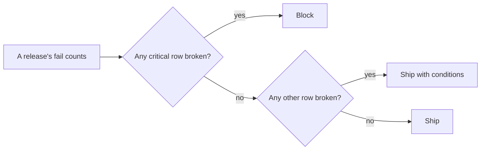

# Set launch criteria

## The problem

Two launch calls are due. If you decide after you see the results, you pick the rule that fits the answer you want. So you write the rules first.

A **launch rule** is a number a release must meet before it ships. You write one rule for each failure mode. Some modes are so serious that they block a launch on their own. We call them **critical**.

For example, the Anthropic docs show success criteria with a number in them, like "95% response time < 200ms" and "99.5% non-toxic outputs". ([Anthropic docs, Define success criteria](https://platform.claude.com/docs/en/test-and-evaluate/develop-tests)) "Looks good" is not a rule. "At most 1 fail in 150 drafts" is.

## Your challenge

This folder has a sample `failure-modes.md` from part 1. You can copy your own over it.

1. Open `launch-criteria.md`. It has a table with six columns.
2. Add one row for each `##` heading in `failure-modes.md`. Copy the name exactly.
3. **Metric**: what you count, like "drafts that fail this mode".
4. **Threshold**: the most fails you accept, as a number, like `at most 1`. You can also use a share, like `at most 2%`.
5. **Measured on**: the set and its size. The release results in `world/data/releases/` use 150 drafts. Use 30 drafts or more.
6. **Critical**: `yes` or `no`. Ask: would this mistake hurt a traveller if no designer caught it?
7. **Owner**: the person who acts when the row fails.

Write the rules before you open the release results. That is the point.

This is how the rules work in the next step:



## Done when

- launch-criteria.md has a table: Mode, Metric, Threshold, Measured on, Critical, Owner.
- Every mode in failure-modes.md has a row, spelled the same.
- Every mode is one the release results measure.
- Every Threshold is a number, like at most 1.
- Every Measured on names a set of 30 drafts or more.
- Critical is yes or no on every row, and at least one row says yes.
- Every row names an Owner.

```bash
bun run verify set-launch-criteria
```

Expect: `Done. All 7 rules pass.` and a `Progress:` line.

## If you get stuck

Find your `FAIL` line on the left. Do the fix on the right.

| What you see                                         | Fix                                                                              |
| ---------------------------------------------------- | -------------------------------------------------------------------------------- |
| `FAIL every mode in failure-modes.md has a row`      | Copy each heading into the Mode column, word for word.                           |
| `FAIL every mode is one the release results measure` | Name what happened, like `Over budget`, so it matches a column in `summary.csv`. |
| `FAIL every Threshold is a number`                   | Change words like "low" into a number.                                           |
| `FAIL Critical is yes or no`                         | Mark at least one mode `yes`.                                                    |

## Words you will use

- **Launch rule**: a number a release must meet before it ships.
- **Threshold**: the number in the rule, like at most 1 fail.
- **Critical**: a mode that blocks the launch on its own, whatever the average says.
- **Owner**: the person who acts when a rule fails.
