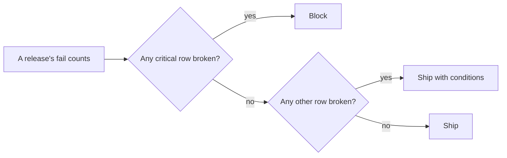

# Set launch criteria

## The problem

Two launch calls are due. If you pick the rule after the results, you pick the answer you want. So write the rule first. A launch rule is a number a release must meet before it ships.

For example, the Anthropic docs use "99.5% non-toxic outputs" as a rule. "Looks good" is not a rule.

## Watch it done

Before: `verify` prints `FAIL every mode in failure-modes.md has a row`.
After: `Done. All 7 rules pass.` and a `Progress:` line.

## Your turn

This folder has a sample `failure-modes.md` from part 1. You can copy your own over it.

1. Open `launch-criteria.md`. It has a table with six columns.
2. Add one row for each `##` heading in `failure-modes.md`. Copy the name exactly.
3. **Metric**: what you count, like "drafts that fail this mode".
4. **Threshold**: the most fails you accept, as a number, like "at most 1" or "at most 2%".
5. **Measured on**: the set and its size. The release results use 150 drafts. Use 30 drafts or more.
6. **Critical**: `yes` or `no`. Ask: would this mistake hurt a traveller if no designer caught it?
7. **Owner**: the person who acts when the row fails.
8. Write the rules before you check the release results. A rule written after you see the answer only repeats it.
9. Run the check.

```bash
bun run verify set-launch-criteria
```

Expect: `Done. All 7 rules pass.` and a `Progress:` line.

How the rules work in the next step:



## Do it on your work

Pick a feature you use or build. Write a row for each of its failure modes, with a number threshold, a Critical flag and an owner. Good looks like: every row has a number someone could count, and at least one row says `yes`.

## Done when

- launch-criteria.md has a table: Mode, Metric, Threshold, Measured on, Critical, Owner.
- Every mode in failure-modes.md has a row, spelled the same.
- Every mode is one the release results measure.
- Every Threshold is a number, like at most 1.
- Every Measured on names a set of 30 drafts or more.
- Critical is yes or no on every row, and at least one row says yes.
- Every row names an Owner.

| What you see                                         | Fix                                                                              |
| ---------------------------------------------------- | -------------------------------------------------------------------------------- |
| `FAIL every mode in failure-modes.md has a row`      | Copy each heading into the Mode column, word for word.                           |
| `FAIL every mode is one the release results measure` | Name what happened, like `Over budget`, so it matches a column in `summary.csv`. |
| `FAIL every Threshold is a number`                   | Change words like "low" into a number.                                           |
| `FAIL Critical is yes or no`                         | Mark at least one mode `yes`.                                                    |

## Solution

`solution/launch-criteria.md` holds the finished table. Each mode has a number, a Critical flag and an owner.
