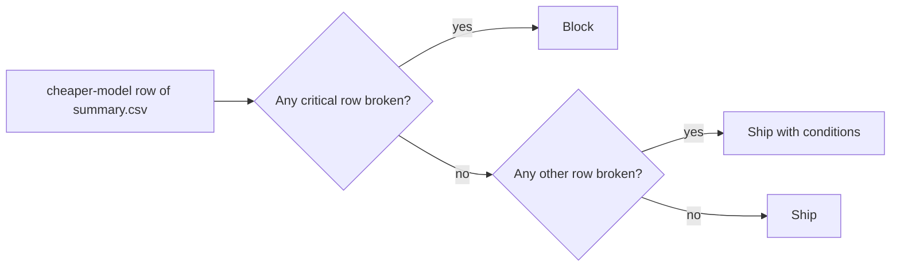

# Compare the releases

## The problem

The engineers want to switch to the cheaper model. It passes more drafts in total, and it costs a third as much. On the average, it wins.

But you wrote launch rules in the last step. Now you apply them, row by row, and let the rules decide.

For example, `world/data/releases/summary.csv` says the cheaper model passes 132 of 150 drafts (88%). The live model passes 129 (86%). But look at the `ignores-mobility` column. The cheaper model fails it 7 times. The live model fails it once.

This matches a public study. In TravelPlanner, one model met 78.3% of the common-sense rules on average. But only 3.8% of its plans passed every rule. ([OSU NLP Group, TravelPlanner](https://github.com/OSU-NLP-Group/TravelPlanner))

## Your challenge

This folder has a sample `launch-criteria.md` and `failure-modes.md`. You can copy your own over them.

1. Open `world/data/releases/summary.csv`. Find the `cheaper-model` row.
2. For each row of your launch criteria, find the matching column. Is the count within your threshold?
3. Decide, with the rule in the picture below:
   - a critical row broken: `block`;
   - only other rows broken: `ship with conditions`;
   - nothing broken: `ship`.
4. Write it in `release-decision.md`, like `Verdict: block`.
5. Under `## The numbers`, copy at least 3 numbers straight from `summary.csv`.
6. If you block, name the critical mode that broke its threshold.

Your verdict must follow your own rules, even if you do not like the answer.

This is the rule you apply:



## Done when

- launch-criteria.md is in this folder and passes its check.
- release-decision.md has a Verdict: line that says ship, block, or ship with conditions.
- It cites at least 3 numbers from world/data/releases/summary.csv.
- The verdict is what your own launch criteria give for the cheaper model.
- A block names the critical mode that broke its threshold.

```bash
bun run verify compare-the-releases
```

Expect: `Done. All 5 rules pass.` and a `Progress:` line.

## If you get stuck

Find your `FAIL` line on the left. Do the fix on the right.

| What you see                           | Fix                                                                     |
| -------------------------------------- | ----------------------------------------------------------------------- |
| `FAIL it cites at least 3 numbers`     | Copy numbers from `summary.csv`, like 132, 150 or 7.                    |
| `FAIL the verdict is what your own`    | Go row by row. A broken critical row means block, whatever the average. |
| `FAIL a block names the critical mode` | Write the mode name as it is in `launch-criteria.md`.                   |

## Words you will use

- **Release**: one version of Draft Planner, here `live` or `cheaper-model`.
- **Verdict**: your decision: ship, block, or ship with conditions.
- **Average**: one number for all drafts together. It can hide a mode that got much worse.
