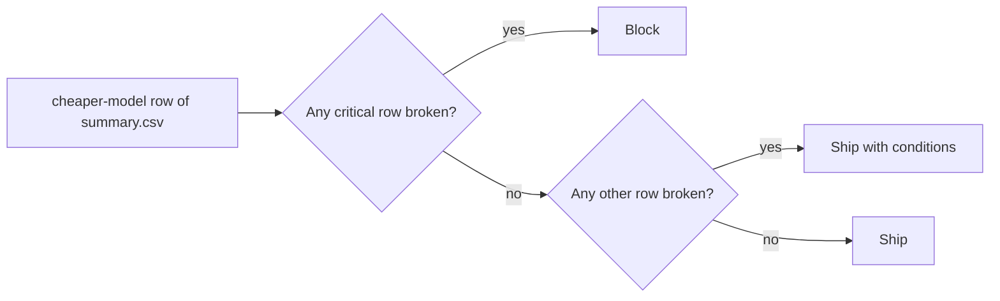

# Compare the releases

## The problem

The engineers want the cheaper model. It passes more drafts in total, so the average says it wins. But you wrote launch rules in the last step. Now let the rules decide.

For example, `world/data/releases/summary.csv` says the cheaper model fails `ignores-mobility` 7 times. The live model fails it once.

## Watch it done

Before: `verify` prints `FAIL it cites at least 3 numbers` when the verdict has too few numbers.
After: `Done. All 7 rules pass.` and a `Progress:` line.

## Your turn

This folder has a sample `launch-criteria.md` and `failure-modes.md`. You can copy your own over them.

1. Open `world/data/releases/summary.csv`. Find the `cheaper-model` row.
2. For each row of your launch criteria, find the matching column. Is the count within your threshold? Short names: `ignores-mobility` is Ignores mobility needs, `impossible-transfer` is Impossible travel, and `diet-missed` is Wrong food for the diet.
3. Decide with the picture below. A critical row broken means `block`. Only other rows broken means "ship with conditions". Nothing broken means `ship`.
4. Write it in `release-decision.md`, like `Verdict: block`.
5. Under the heading The numbers, copy at least 3 numbers straight from `summary.csv`.
6. If you block, name the critical mode that broke its threshold.
7. Open `world/data/releases/repeat-runs.csv`, which holds five runs of each release. Under the heading Repeat runs, write `Runs:` and a `Spread:` line. The spread is the most passes minus the fewest. Then say if the cheaper model's gain is bigger than its spread. A smaller gain may be luck.
8. Your verdict must follow your own rules, even if you do not like the answer.
9. Run the check.

```bash
bun run verify compare-the-releases
```

Expect: `Done. All 7 rules pass.` and a `Progress:` line.



## Do it on your work

Take one release of a feature you own, with its counts. Apply your own criteria row by row and write a verdict. Good looks like: the verdict follows from your rows, and a broken critical row shows as `block` with the mode named.

## Done when

- launch-criteria.md is in this folder and passes its check.
- release-decision.md has a Verdict: line that says ship, block, or ship with conditions.
- It cites at least 3 numbers from world/data/releases/summary.csv.
- The verdict is what your own launch criteria give for the cheaper model.
- A block names the critical mode that broke its threshold.

| What you see                           | Fix                                                                     |
| -------------------------------------- | ----------------------------------------------------------------------- |
| `FAIL it cites at least 3 numbers`     | Copy numbers from `summary.csv`, like 132, 150 or 7.                    |
| `FAIL the verdict is what your own`    | Go row by row. A broken critical row means block, whatever the average. |
| `FAIL a block names the critical mode` | Write the mode name as it is in `launch-criteria.md`.                   |

## Solution

`solution/release-decision.md` shows a finished verdict with its numbers and the repeat-run lines.
