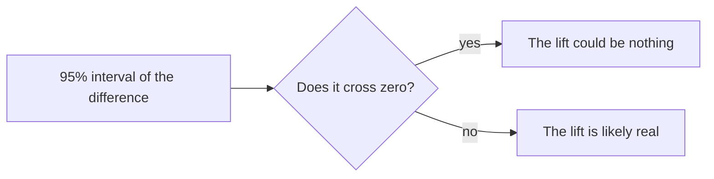

# Read the A/B test

## The problem

Sales wants instant drafts for city breaks, sent with no designer. Bookings went up in a test, so sales wants to ship to everyone. Is the lift real?

For example, `world/data/ab-test.csv` has 1,200 sessions in each arm. The designer arm books 18.0%. The instant arm books 20.0%. That is 2 points more. Is it luck?

## Watch it done

Before: `verify` prints `FAIL the 95% interval` when the margin uses one arm only.
After: `Done. All 6 rules pass.` and a `Progress:` line.

## Your turn

1. Open `world/data/ab-test.csv` in a spreadsheet. Then fill in `ab-decision.md`, line by line.
2. **Booking rate per arm**: sessions with `booked` = 1, divided by all sessions in that arm.
3. **Difference**: instant rate minus designer rate, in points.
4. **95% interval**: work out the margin, then go that far either side of the difference.
   - margin = 1.96 x square root of ( p1 x (1 - p1) / n1 + p2 x (1 - p2) / n2 )
   - p1 and p2 are the two rates, as shares like 0.18. n1 and n2 are the sessions in each arm.
5. **Crosses zero**: `yes` if the low end is below 0 and the high end above 0.
6. **Refund guardrail**: the rule is "closed on arrival refunds stay at or below 0.5% of sessions". Count rows where `refund_reason` says "closed on arrival" in the instant arm. Write `breached` or `held`.
7. **Decision**: one of "ship to all", "ship to a segment", "keep testing" or "do not ship". Never write "ship to all" while the interval crosses zero or the guardrail is breached.
8. Under `## Why`, explain your decision in two or three sentences.
9. Extension: split the bookings by `trip_type`. Where does the lift come from?
10. Run the check.

```bash
bun run verify read-the-ab-test
```

Expect: `Done. All 6 rules pass.` and a `Progress:` line.

How to read an interval:



## Do it on your work

Pick a test of your own with two groups and a yes or no result. Work out each arm's rate and the interval. Good looks like: a lift whose interval crosses zero is never called a ship.

## Done when

- ab-decision.md states each arm's booking rate within 0.5 points.
- The Difference: is within 0.5 points.
- The 95% interval: low and high ends are each within 0.5 points.
- Crosses zero: says yes or no, and it is right.
- The Refund guardrail: says breached or held, and it is right.
- The Decision: is one of the four choices, and never ship to all on a shaky result.

| What you see                | Fix                                                              |
| --------------------------- | ---------------------------------------------------------------- |
| `FAIL the 95% interval`     | Use both arms in the margin. Write it like `-1.1 to 5.1 points`. |
| `FAIL the Refund guardrail` | Count only closed on arrival refunds, in the instant arm.        |
| `FAIL the Decision`         | Pick one of the four choices, spelled the same.                  |

## Solution

`solution/ab-decision.md` holds the finished memo with its rates, interval and decision.
