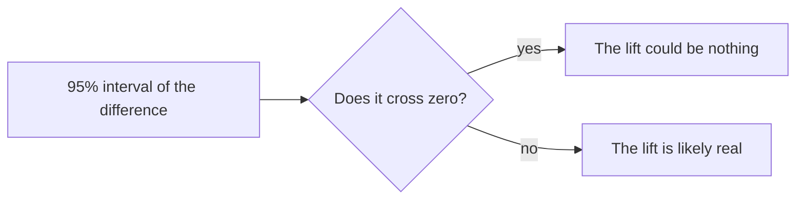

# Read the A/B test

## The problem

Sales wants instant drafts for city breaks, sent with no designer. In a test, each customer saw one of two versions:

- `designer`: a designer checks the draft first, as today.
- `instant`: the draft goes out at once.

Bookings went up, so sales wants to ship to everyone. Is the lift real, and what does it cost?

For example, `world/data/ab-test.csv` has 1,200 sessions in each arm. In the designer arm, 216 booked, so 18.0%. In the instant arm, 240 booked, so 20.0%. That is 2 points more. But is 2 points more than luck?

## Your challenge

Open `world/data/ab-test.csv` in a spreadsheet. Then fill in `ab-decision.md`, line by line.

1. **Booking rate per arm**: sessions with `booked` = 1, divided by all sessions in that arm.
2. **Difference**: instant rate minus designer rate, in points.
3. **95% interval**: work out the margin, then go that far either side of the difference.
   - margin = 1.96 x square root of ( p1 x (1 - p1) / n1 + p2 x (1 - p2) / n2 )
   - p1 and p2 are the two rates, as shares like 0.18. n1 and n2 are the sessions in each arm.
4. **Crosses zero**: `yes` if the low end is below 0 and the high end above 0.
5. **Refund guardrail**: the rule is "closed on arrival refunds stay at or below 0.5% of sessions". Count rows with `refund_reason` = `closed on arrival` in the instant arm. Write `breached` or `held`.
6. **Decision**: one of `ship to all`, `ship to a segment`, `keep testing`, `do not ship`.
7. Under `## Why`, explain your decision in two or three sentences.

Never write "ship to all" while the interval crosses zero or the guardrail is breached.

Extension: split the bookings by `trip_type`. Where does the lift come from?

This is how to read an interval:



## Done when

- ab-decision.md states each arm's booking rate within 0.5 points.
- The Difference: is within 0.5 points.
- The 95% interval: low and high ends are each within 0.5 points.
- Crosses zero: says yes or no, and it is right.
- The Refund guardrail: says breached or held, and it is right.
- The Decision: is one of the four choices, and never ship to all on a shaky result.

```bash
bun run verify read-the-ab-test
```

Expect: `Done. All 6 rules pass.` and a `Progress:` line.

## If you get stuck

Find your `FAIL` line on the left. Do the fix on the right.

| What you see                | Fix                                                              |
| --------------------------- | ---------------------------------------------------------------- |
| `FAIL the 95% interval`     | Use both arms in the margin. Write it like `-1.1 to 5.1 points`. |
| `FAIL the Refund guardrail` | Count only closed on arrival refunds, in the instant arm.        |
| `FAIL the Decision`         | Pick one of the four choices, spelled the same.                  |

## Words you will use

- **A/B test**: two versions shown to two groups at the same time. Each group is an **arm**.
- **Point**: one percent, as a difference. 18% to 20% is 2 points.
- **95% interval**: the range where the true difference most likely is.
- **Guardrail**: a number that must not get worse, even if the main number gets better.
- **Segment**: one part of the customers, like Lisbon weekends.
