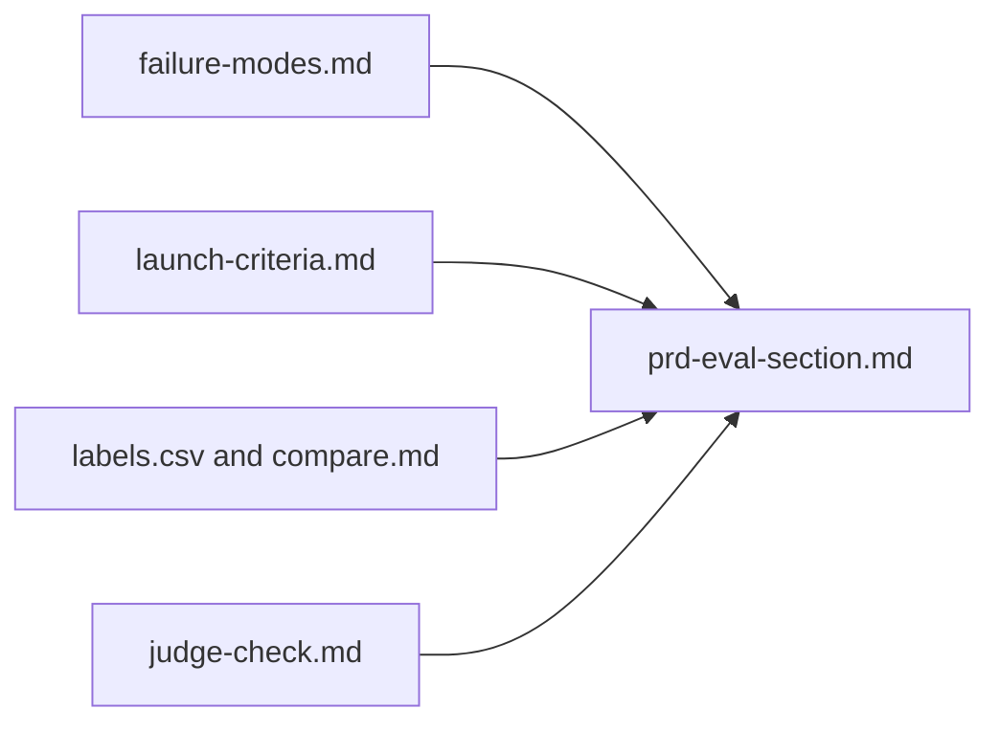

# Write the eval section

## The problem

The next person on the team will not read all your files. They read the product spec, or **PRD** (product requirements document). So you write one section of it: how Draft Planner is measured.

For example, the sample answer's launch rule says: "Ignores mobility needs and Wrong food for the diet are critical."

## Watch it done

Before: `verify` prints `FAIL Launch rule names every critical` when a critical mode is missing from the section.
After: `Done. All 9 rules pass.` and a `Progress:` line.

## Your turn

This folder has a sample `launch-criteria.md` and `failure-modes.md`. You can copy your own over them.

1. Open `prd-eval-section.md`. Fill in each of the seven sections.
2. **User outcome**: what a good draft does for the customer and the designer. Add one line that starts with Business case:. Say who pays when a draft fails, give one number, and compare it, like a refund against the cost of a draft.
3. **Failure modes**: every mode from `failure-modes.md`, each with one line.
4. **Metrics and thresholds**: one line per mode, with the same number as in `launch-criteria.md`.
5. **Golden set**: `Size:`, `Owner:` and `Refresh when:` lines. Refresh means adding new drafts so the set keeps up with real use.
6. **Judges**: the judge you trust, with its `TPR:` and `TNR:`. Copy them from your `judge-check.md` in part 3, like `TPR: 0.93`. Both must be 0.80 or more.
7. **Launch rule**: how a release ships or is blocked. Name every critical mode.
8. **After launch**: what you read once it is live, and when you act.
9. Use the words from your files. If the spec and `launch-criteria.md` disagree, nobody knows which is true.
10. Run the check.

```bash
bun run verify write-the-eval-section
```

Expect: `Done. All 9 rules pass.` and a `Progress:` line.



## Do it on your work

Write the seven sections for a feature of your own, in the same order. Good looks like: each threshold matches your own launch rule file, and each critical mode is named in the launch rule.

## Done when

- launch-criteria.md and failure-modes.md are here and pass set-launch-criteria.
- prd-eval-section.md has the seven ## headings, in order.
- Every section has at least 8 words.
- Failure modes names every mode in failure-modes.md.
- Metrics and thresholds gives each mode the same threshold as launch-criteria.md.
- Golden set has Size: (30 or more), Owner: and Refresh when: lines.
- Judges states a TPR: and a TNR: of 0.80 or more for the judge you trust.
- Launch rule names every critical mode.

| What you see                             | Fix                                                          |
| ---------------------------------------- | ------------------------------------------------------------ |
| `FAIL the seven ## headings, in order`   | Keep the starter headings and their order.                   |
| `FAIL Metrics and thresholds gives each` | Copy each threshold number from `launch-criteria.md`.        |
| `FAIL Golden set has Size:`              | Write all three lines, each with its value on the same line. |
| `FAIL Launch rule names every critical`  | Name each mode marked `yes` in the Critical column.          |

## Solution

`solution/prd-eval-section.md` holds the finished seven sections. Its thresholds match `solution/launch-criteria.md`.
