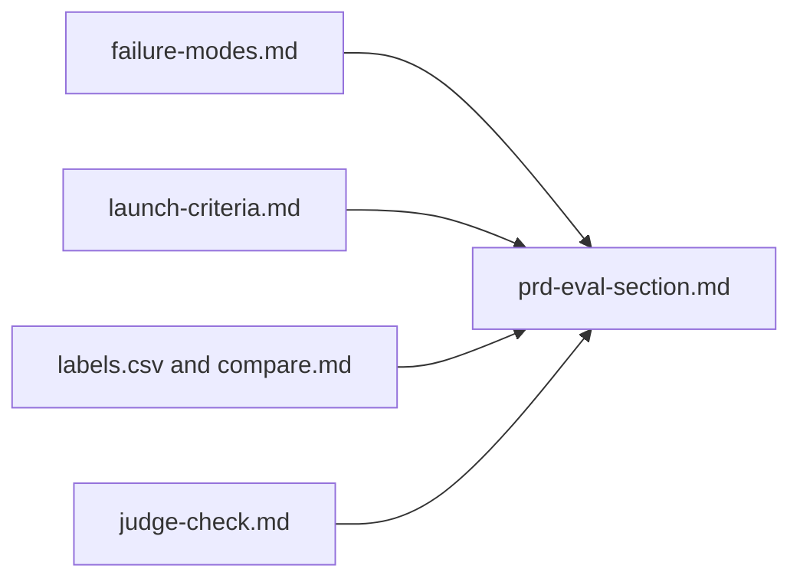

# Write the eval section

## The problem

Your work is spread over many files. The next person on the team will not read them all. A product spec, or **PRD** (product requirements document), is where the team looks. So you write one section of it: how Draft Planner is measured.

Descript, a video editing company, grades its AI features with "criteria defined by the product team". ([Anthropic, Demystifying evals for AI agents](https://www.anthropic.com/engineering/demystifying-evals-for-ai-agents)) The PRD is where your team writes those criteria down.

For example, the Launch rule section of the sample answer says: "Ignores mobility needs and Wrong food for the diet are critical. Each one blocks a launch on its own."

## Your challenge

This folder has a sample `launch-criteria.md` and `failure-modes.md`. You can copy your own over them.

Open `prd-eval-section.md`. Fill in each of the seven sections:

1. **User outcome**: what a good draft does for the customer and the designer.
2. **Failure modes**: every mode from `failure-modes.md`, each with one line.
3. **Metrics and thresholds**: one line per mode, with the same number as in `launch-criteria.md`.
4. **Golden set**: `Size:`, `Owner:` and `Refresh when:` lines.
5. **Judges**: the judge you trust, with its `TPR:` and `TNR:`.
6. **Launch rule**: how a release ships or is blocked. Name every critical mode.
7. **After launch**: what you read once it is live, and when you act.

Use the words from your files. If the spec says one number and `launch-criteria.md` says another, nobody knows which is true.

This is where each section comes from:



## Done when

- launch-criteria.md and failure-modes.md are here and pass set-launch-criteria.
- prd-eval-section.md has the seven ## headings, in order.
- Every section has at least 8 words.
- Failure modes names every mode in failure-modes.md.
- Metrics and thresholds gives each mode the same threshold as launch-criteria.md.
- Golden set has Size: (30 or more), Owner: and Refresh when: lines.
- Judges states a TPR: and a TNR: for the judge you trust.
- Launch rule names every critical mode.

```bash
bun run verify write-the-eval-section
```

Expect: `Done. All 8 rules pass.` and a `Progress:` line.

## If you get stuck

Find your `FAIL` line on the left. Do the fix on the right.

| What you see                             | Fix                                                          |
| ---------------------------------------- | ------------------------------------------------------------ |
| `FAIL the seven ## headings, in order`   | Keep the starter headings and their order.                   |
| `FAIL Metrics and thresholds gives each` | Copy each threshold number from `launch-criteria.md`.        |
| `FAIL Golden set has Size:`              | Write all three lines, each with its value on the same line. |
| `FAIL Launch rule names every critical`  | Name each mode marked `yes` in the Critical column.          |

## Words you will use

- **PRD**: product requirements document, the spec that says what a product must do.
- **Eval**: a test of how well an AI feature does its job.
- **Refresh**: add new drafts to the golden set, so it keeps up with real use.
