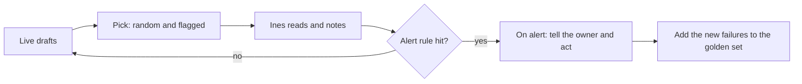

# Plan the weekly review

This is an extension step. You can skip it.

## The problem

Customers send new kinds of requests, so a draft that passed the golden set can still fail. Plan one review of 20 or more live drafts each cycle.

For example, the cheaper model fails 7 of 26 step-free requests. A review of live drafts catches that kind of miss early.

## Watch it done

Before: the Alert rule line has no number. The check stops with `FAIL the Alert rule: has a number`.
After: the same check prints `Done. All 6 rules pass.` and a `Progress:` line.

## Your turn

A **cycle** is one round of the review. A **flagged draft** shows a sign of trouble, like a refund request. An **alert rule** is a number that tells you to act.

1. Open `review-plan.md`. Fill in each line, with the value on the same line as its label.
2. **Drafts each cycle**: how many live drafts are read each time. 20 or more.
3. **Mix**: use both kinds: some at random, some flagged by a refund request or a designer rewrite.
4. **Reader**: who reads them. Name one person.
5. **Minutes**: how long the reading takes. Allow a short look at each draft.
6. **Alert rule**: when to act, as a number. For example: more than 1 mobility fail in 30 drafts.
7. **On alert**: who does what when the alert fires.

This is the loop your plan sets up:



8. Run the check.

```bash
bun run verify plan-the-weekly-review
```

Expect: `Done. All 6 rules pass.` and a `Progress:` line.

## Do it on your work

Write a review plan for your own AI feature. Good looks like this. One line for each label, a random pick and a flagged pick, one named reader, and an alert rule with a number.

## Done when

- review-plan.md states Drafts each cycle: as a number, 20 or more.
- The Mix: line has drafts picked at random and drafts flagged by a refund or a rewrite.
- The Reader: line names who reads the drafts.
- The Minutes: line gives the reading time as a number.
- The Alert rule: has a number in it.
- The On alert: line says in 6 or more words what happens next.

| What you see                        | Fix                                                                     |
| ----------------------------------- | ----------------------------------------------------------------------- |
| `FAIL the Mix: line has`            | Use the word random, and say what flags a draft: a refund or a rewrite. |
| `FAIL the Alert rule: has a number` | Change "when things look bad" into a count, like more than 1 in 30.     |
| `FAIL the Reader: line names`       | Write the value on the same line as the label.                          |

## Solution

The finished plan is in `solution/review-plan.md`. Every line is filled in, and the alert rule has a number.
