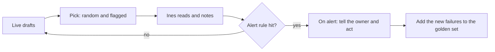

# Plan the weekly review

This is an extension step. You can skip it.

## The problem

A launch is not the end. Customers send new kinds of requests. The catalogue changes. A draft that passed the golden set can still fail later in a new way. If nobody reads live drafts, you hear about it from refunds.

So you plan a review: a fixed number of live drafts that someone reads each cycle, with a rule for when to act.

For example, Anthropic's guide to agent evals says teams should "sample transcripts to read weekly, and dig deeper as needed". ([Anthropic, Demystifying evals for AI agents](https://www.anthropic.com/engineering/demystifying-evals-for-ai-agents)) A transcript is what this course calls a trace.

## Your challenge

Open `review-plan.md`. Fill in each line, with the value on the same line as its label.

1. **Drafts each cycle**: how many live drafts are read each time. 20 or more.
2. **Mix**: how they are picked. Use both kinds:
   - some at random, to find problems nobody has seen yet;
   - some flagged by a refund request or a designer rewrite, to find the costly ones.
3. **Reader**: who reads them. Name one person.
4. **Minutes**: how long the reading takes. Allow about 1 to 2 minutes a draft.
5. **Alert rule**: when to act, as a number. For example: more than 1 mobility fail in 30 drafts.
6. **On alert**: who does what when the alert fires.

This is the loop your plan sets up:



## Done when

- review-plan.md states Drafts each cycle: as a number, 20 or more.
- The Mix: line has drafts picked at random and drafts flagged by a refund or a rewrite.
- The Reader: line names who reads the drafts.
- The Minutes: line gives the reading time as a number.
- The Alert rule: has a number in it.
- The On alert: line says in 6 or more words what happens next.

```bash
bun run verify plan-the-weekly-review
```

Expect: `Done. All 6 rules pass.` and a `Progress:` line.

## If you get stuck

Find your `FAIL` line on the left. Do the fix on the right.

| What you see                        | Fix                                                                     |
| ----------------------------------- | ----------------------------------------------------------------------- |
| `FAIL the Mix: line has`            | Use the word random, and say what flags a draft: a refund or a rewrite. |
| `FAIL the Alert rule: has a number` | Change "when things look bad" into a count, like more than 1 in 30.     |
| `FAIL the Reader: line names`       | Write the value on the same line as the label.                          |

## Words you will use

- **Cycle**: one round of the review, repeated on a fixed schedule.
- **Flagged draft**: a draft with a sign of trouble, like a refund request or a rewrite.
- **Alert rule**: a number that tells you to stop and act.
