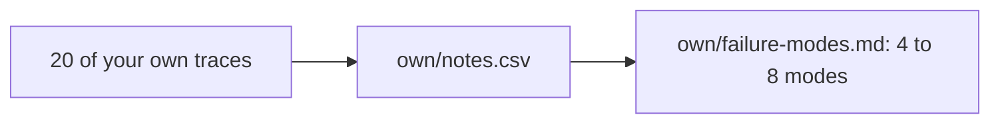

# Bring your own traces

This is an extension step. You can skip it.

## The problem

Lantern Trails is practice. Your own AI feature is the real thing. The same method works on it: read, write notes, then group the notes into failure modes.

You do it here on 20 of your own traces. Nothing leaves your computer. The check reads only your two files.

For example, a farm advice assistant answers farmers from an expert fact sheet. One of its notes might say: "Says to spray the maize twice the dose on the fact sheet." The sample answer in `solution/own/` shows 20 such notes and four modes.

## Your challenge

1. Pick 20 traces from your own AI feature. A mix of random ones and ones users complained about works best.
2. Remove names, emails and other personal data first.
3. Give each trace a short id, like `F01`.
4. In `own/notes.csv`, write one row per trace: its id and your note. Write `ok` if nothing is wrong. Otherwise write what you saw, in at least 6 words.
5. In `own/failure-modes.md`, group the notes that are not `ok`. For each group, write a `##` name, a `Definition:` line and a `Traces:` line.

No AI feature of your own yet? Pick one you use at work or at home, and write down 20 of its answers.

This is the same path as part 1:



## Done when

- own/notes.csv has 20 rows, each with its own trace_id and a note.
- Every note is ok or has at least 6 words.
- At least 2 notes are ok and at least 8 are not.
- own/failure-modes.md names 4 to 8 modes, each under its own ## heading.
- Every mode has a Definition: line of at least 6 words.
- Every mode lists 2 or more traces, each with a note that is not ok.
- No mode is named with only a vague word like quality or accuracy.
- Together the modes cover at least 8 in 10 of your notes that are not ok.

```bash
bun run verify bring-your-own-traces
```

Expect: `Done. All 8 rules pass.` and a `Progress:` line.

## If you get stuck

Find your `FAIL` line on the left. Do the fix on the right.

| What you see                                          | Fix                                                |
| ----------------------------------------------------- | -------------------------------------------------- |
| `FAIL at least 2 notes are ok and at least 8 are not` | Add traces users complained about.                 |
| `FAIL every mode lists 2 or more traces`              | Use the ids from `own/notes.csv`, split by commas. |
| `FAIL no mode is named with only a vague word`        | Name what happened, like "Wrong spray dose".       |

## Words you will use

- **Trace**: the full record of one run of your AI feature: what went in and what came out.
- **Personal data**: anything that points to a real person, like a name or an email.
