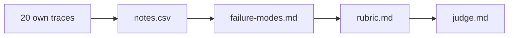

# Bring your own traces

## The problem

Lantern Trails is practice. Your own AI feature is the real thing. Read the traces, write notes, then group them into failure modes. Nothing leaves your computer.

For example, a farm advice assistant answers farmers from an expert fact sheet. One note reads: "Says to spray the maize twice the dose on the fact sheet."

## Watch it done

Before: `verify` prints `FAIL at least 2 notes are ok` when notes.csv has fewer than 2 ok rows.
After: `Done. All 13 rules pass.` and a `Progress:` line.

## Your turn

This is an extension step. You can skip it.

1. Pick 20 traces from your own AI feature. A mix of random ones and ones users complained about works best.
2. Remove names, emails and other personal data first.
3. Give each trace a short id, like `F01`.
4. In `own/notes.csv`, write one row per trace: its id and your note. Write `ok` if nothing is wrong. Otherwise write what you saw, in at least 6 words.
5. In `own/failure-modes.md`, group the notes that are not `ok`. For each group, write a `##` name, a `Definition:` line and a `Traces:` line.
6. In `own/rubric.md`, write the rule for the mode with the most traces: Pass, Fail, a Borderline rule, and examples from your own ids. Add a `Checked by:` line. Say code if a plain rule can see the failure. Say judge if a person has to read it. Give the reason.
7. In `own/judge.md`, turn that rubric into a judge prompt. Copy the Pass and Fail text. List 2 to 4 of your ids as examples. Ask for a critique first, then the verdict.
8. No AI feature of your own yet? Pick one you use at work or at home, and write down 20 of its answers.
9. Run the check.

```bash
bun run verify bring-your-own-traces
```

Expect: `Done. All 13 rules pass.` and a `Progress:` line.



## Do it on your work

Your own feature is the work. Good looks like: the 20 notes are real, personal data is removed, and each mode lists 2 or more traces.

## Done when

- Your 20 notes are in `own/notes.csv`, with at least 2 ok and at least 8 that are not.
- `own/failure-modes.md` has 4 to 8 clear modes. Each has a definition and 2 or more traces.
- The modes cover at least 8 in 10 of your notes that are not ok.
- `own/rubric.md` has its four headings, your own ids as examples, and a `Checked by:` line.
- `own/judge.md` holds the rubric text, asks for a critique first, and shows 2 to 4 of your ids.

| What you see                             | Fix                                |
| ---------------------------------------- | ---------------------------------- |
| `FAIL at least 2 notes are ok`           | Add traces users complained about. |
| `FAIL every mode lists 2 or more traces` | Use ids from `own/notes.csv`.      |

## Solution

`solution/own/` shows a finished set of notes, modes, a rubric and a judge prompt.
