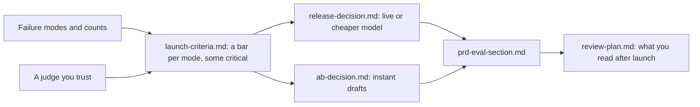

# Decide and write it down

Status: TODO(part session). This README is the plan. The step folders do not exist yet.

## The problem

Two calls are due. Engineering wants the cheaper model: it passes more drafts overall and costs a third as much. Sales wants instant drafts for city breaks: bookings went up in the test. A call made on the headline number ships both. A call made on rules you wrote first may not.

## Why it matters

Anthropic's docs show what a launch rule with a number looks like: "an F1 score of at least 0.85" on "a held-out test set of 10,000 diverse Twitter posts", and "99.5% non-toxic outputs". ([Anthropic docs, Define success criteria](https://platform.claude.com/docs/en/test-and-evaluate/develop-tests)) Averages hide failures. In the TravelPlanner study of AI trip planning, one fine-tuned model met 78.3% of the commonsense rules, but only 3.8% of its plans passed every rule. ([OSU NLP Group, TravelPlanner](https://github.com/OSU-NLP-Group/TravelPlanner))



## Steps

| Step                               | Minutes | You make                                | The check reads                                                                                                                                                                                                                                                |
| ---------------------------------- | ------- | --------------------------------------- | -------------------------------------------------------------------------------------------------------------------------------------------------------------------------------------------------------------------------------------------------------------- |
| set-launch-criteria                | 20      | `launch-criteria.md`                    | A table: mode, metric, threshold (a number), measured on (set and size), critical yes or no, owner. Every mode from `failure-modes.md` appears. At least one is critical. Every size is 30 or more                                                             |
| compare-the-releases               | 15      | `release-decision.md`                   | A verdict: ship, block or ship with conditions. At least 3 numbers, each found in `world/data/releases/`. The verdict equals what the learner's own criteria give on the data                                                                                  |
| read-the-ab-test                   | 25      | `ab-decision.md`                        | Booking rate per arm and the difference with a 95% interval, each within 0.5 points of `world/data/ab-test.csv`. Whether the interval crosses zero. The refund guardrail result. No "ship to all" while the interval crosses zero or the guardrail is breached |
| write-the-eval-section             | 25      | `prd-eval-section.md`                   | Headings: User outcome, Failure modes, Metrics and thresholds, Golden set, Judges, Launch rule, After launch. Mode names and thresholds match the earlier files                                                                                                |
| plan-the-weekly-review (extension) | 20      | `review-plan.md`                        | Drafts read each cycle, the mix (random plus flagged), who reads them, minutes, an alert rule with a number, and what happens on an alert                                                                                                                      |
| bring-your-own-traces (extension)  | 20      | `own/notes.csv`, `own/failure-modes.md` | The same rules as read-the-traces and name-the-failure-modes, on 20 of the learner's own traces                                                                                                                                                                |

Planted numbers, already in the world: on 150 held-out requests the live model passes 129 (86%) and the cheaper model 132 (88%), but the cheaper model fails 7 of 26 step-free requests against 1 of 26. The A/B test has 1,200 sessions an arm: bookings 18.0% against 20.0%, an interval that crosses zero, more "closed on arrival" refunds in the instant arm, and a lift only in Lisbon weekends. `tests/world.test.ts` guards them.

## Walkthrough

TODO(part session): write the walkthrough once the steps exist.

```bash
bun run verify part decide-and-write-it-down
```

Expect: TODO(part session). Once the steps exist: `Part decide-and-write-it-down is done: 6/6 steps pass.`
