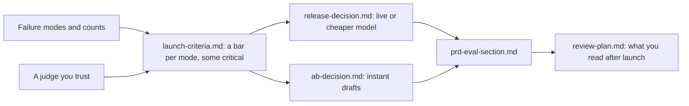

# Decide and write it down

## The problem

Two choices are due, and the boss wants your answer on both.

- The engineers want the cheaper AI model. It passes more drafts in total, and it costs a third as much.
- The sales team wants instant drafts for city breaks. An instant draft goes to the customer with no designer. In a test, more people booked.

If you look only at the main number, both choices look good, and you ship both. But first you write your own **launch rules**: the numbers a feature must meet before it ships. With those rules, the answer may change.

For example, look at `world/data/releases/summary.csv`. Both models ran on the same 150 requests:

- The live model passes 129 of 150 drafts (86%).
- The cheaper model passes 132 of 150 drafts (88%).

So the cheaper model looks better. But 26 of the 150 requests are from travellers who need step-free places. The cheaper model fails 7 of those 26. The live model fails only 1. If your launch rule says "no more than 1 in 26 for step-free travellers", the cheaper model is blocked.

## Why it matters

A good launch rule has a number in it. Anthropic's docs give examples, like "99.5% non-toxic outputs" and "95% response time < 200ms". The first means at least 99.5% of replies are free of rude or harmful words. ([Anthropic docs, Define success criteria](https://platform.claude.com/docs/en/test-and-evaluate/develop-tests))

An average can hide failures. The TravelPlanner study tested AI trip planners. One model met 78.3% of the common-sense rules on average. But only 3.8% of its plans met every rule. ([OSU NLP Group, TravelPlanner](https://github.com/OSU-NLP-Group/TravelPlanner))

This is the path you take in this part:



## Steps

| Step                                                                              | Minutes | You make                                | The check reads                                                                                      |
| --------------------------------------------------------------------------------- | ------- | --------------------------------------- | ---------------------------------------------------------------------------------------------------- |
| [set-launch-criteria](01-set-launch-criteria/problem/README.md)                   | 20      | `launch-criteria.md`                    | A row per mode with a number threshold, a set of 30 or more, a critical flag and an owner            |
| [compare-the-releases](02-compare-the-releases/problem/README.md)                 | 15      | `release-decision.md`                   | A verdict that equals your own criteria applied to `world/data/releases/summary.csv`, with 3 numbers |
| [read-the-ab-test](03-read-the-ab-test/problem/README.md)                         | 25      | `ab-decision.md`                        | Rates, difference and 95% interval within 0.5 points, the guardrail, and a decision that follows     |
| [write-the-eval-section](04-write-the-eval-section/problem/README.md)             | 25      | `prd-eval-section.md`                   | Seven headings in order, mode names and thresholds that match your earlier files                     |
| [plan-the-weekly-review](05-plan-the-weekly-review/problem/README.md) (extension) | 20      | `review-plan.md`                        | Drafts each cycle, a random and flagged mix, a reader, minutes, an alert rule with a number          |
| [bring-your-own-traces](06-bring-your-own-traces/problem/README.md) (extension)   | 20      | `own/notes.csv`, `own/failure-modes.md` | The read-the-traces and name-the-failure-modes rules, on 20 of your own traces                       |

Some words from the table:

- A **threshold** is the number a feature must reach to pass a launch rule.
- A **critical** mode is one so serious that it blocks the launch on its own.
- An **A/B test** shows two versions to two groups of customers at the same time. Each group is an **arm**.
- A **95% interval** is the range where the true difference most likely is. If the range includes zero, there may be no real difference.
- A **guardrail** is a number that must not get worse, like refunds, even if the main number gets better.
- A **PRD** (product requirements document) is the spec that says what the product must do.
- An **extension** is an extra step. You can skip it.

The numbers are already planted in the world. The A/B test has 1,200 sessions in each arm. Bookings are 18.0% with a designer and 20.0% with instant drafts. But the interval crosses zero. The instant arm also has more refunds for places that were "closed on arrival". And the extra bookings come only from Lisbon weekends. The file `tests/world.test.ts` makes sure these numbers do not change.

## Walkthrough

Do the steps in order. Each step checks the files in its own `problem` folder. Each starter holds the sample files it needs from earlier steps, so you can start any step.

```bash
bun run verify set-launch-criteria
```

Expect: `Done. All 7 rules pass.` once `launch-criteria.md` has a row for every mode.

```bash
bun run verify compare-the-releases
```

Expect: `Done. All 5 rules pass.` once your verdict follows your criteria.

```bash
bun run verify read-the-ab-test
```

Expect: `Done. All 6 rules pass.` once `ab-decision.md` has the numbers and a decision.

```bash
bun run verify write-the-eval-section
```

Expect: `Done. All 8 rules pass.` once all seven sections of `prd-eval-section.md` are filled in.

The last two steps are extensions. Skip them if you are short of time.

```bash
bun run verify plan-the-weekly-review
```

Expect: `Done. All 6 rules pass.` once `review-plan.md` has every line.

```bash
bun run verify bring-your-own-traces
```

Expect: `Done. All 8 rules pass.` once your 20 notes and your modes are in `own/`.

When all six steps pass, check the whole part:

```bash
bun run verify part decide-and-write-it-down
```

Expect: `Part decide-and-write-it-down is done: 6/6 steps pass.`

## Assignment

The problem: two launch calls are due, and both look good on the main number.

Hand in `launch-criteria.md`, `release-decision.md`, `ab-decision.md` and `prd-eval-section.md`. The steps above check them. In a cohort, a grader also asks these yes or no questions:

| #   | Question                                                                                            | Check                    |
| --- | --------------------------------------------------------------------------------------------------- | ------------------------ |
| 1   | Does every failure mode have a number threshold, a set of 30 or more, and a critical flag?          | `set-launch-criteria`    |
| 2   | Does the release verdict equal what your own criteria give on the data?                             | `compare-the-releases`   |
| 3   | Does the A/B memo avoid "ship to all" while the interval crosses zero or the guardrail is breached? | `read-the-ab-test`       |
| 4   | Do the mode names and thresholds in the PRD section match the earlier files?                        | `write-the-eval-section` |

Four yes answers is a pass.

Extension: `plan-the-weekly-review`, and the trip-type split that shows where the A/B lift comes from. For a "zero fails" threshold, also state the 95% upper bound: about 3 divided by the set size. For example, 0 fails in 150 drafts still allows a true rate of up to 2%.

## Finished

You now have the full launch pack. It holds counts of what goes wrong, a rubric, a check on the judge, launch rules, two decisions with their numbers, and a PRD section. For example, the sample answer blocks the cheaper model. It passes 88% of drafts against 86%, but it fails wheelchair users on 7 drafts against 1.

This is the last part. Put your files together with `bun run verify --report`, which writes `verify-report.json`. Then use the same method on your own AI feature, starting with `bring-your-own-traces`.
