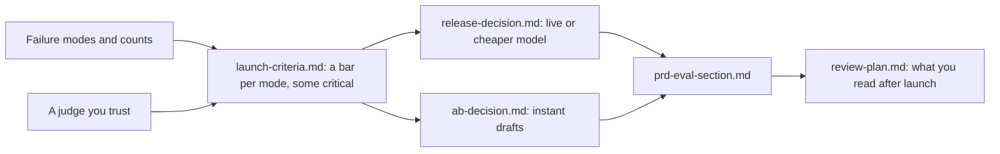

# Decide and write it down

Status: TODO(part session). This README is the plan. The step folders do not exist yet.

## The problem

Two choices are due, and the boss wants your answer on both.

- The engineers want the cheaper AI model. It passes more drafts in total, and it costs a third as much.
- The sales team wants instant drafts for city breaks. An instant draft goes to the customer with no designer. In a test, more people booked.

If you look only at the main number, both choices look good, and you ship both. But first you write your own **launch rules**: the numbers a feature must meet before it ships. With those rules, the answer may change.

For example, look at `world/data/releases/summary.csv`. Both models ran on the same 150 requests:

- The live model passes 129 of 150 drafts (86%).
- The cheaper model passes 132 of 150 drafts (88%).

So the cheaper model looks better. But 26 of the 150 requests are from travellers who need step-free places. The cheaper model fails 7 of those 26. The live model fails only 1. If your launch rule says "no more than 1 in 26 for step-free travellers", the cheaper model is blocked.

## Why it matters

A good launch rule has a number in it. Anthropic's docs give examples, like "99.5% non-toxic outputs". That means at least 99.5% of replies must be free of rude or harmful words. ([Anthropic docs, Define success criteria](https://platform.claude.com/docs/en/test-and-evaluate/develop-tests))

An average can hide failures. The TravelPlanner study tested AI trip planners. One model met 78.3% of the common-sense rules on average. But only 3.8% of its plans met every rule. ([OSU NLP Group, TravelPlanner](https://github.com/OSU-NLP-Group/TravelPlanner))

This is the path you take in this part:



## Steps

| Step                               | Minutes | You make                                | The check reads                                                                                                                                                                                                                                                |
| ---------------------------------- | ------- | --------------------------------------- | -------------------------------------------------------------------------------------------------------------------------------------------------------------------------------------------------------------------------------------------------------------- |
| set-launch-criteria                | 20      | `launch-criteria.md`                    | A table: mode, metric, threshold (a number), measured on (set and size), critical yes or no, owner. Every mode from `failure-modes.md` appears. At least one is critical. Every size is 30 or more                                                             |
| compare-the-releases               | 15      | `release-decision.md`                   | A verdict: ship, block or ship with conditions. At least 3 numbers, each found in `world/data/releases/`. The verdict equals what the learner's own criteria give on the data                                                                                  |
| read-the-ab-test                   | 25      | `ab-decision.md`                        | Booking rate per arm and the difference with a 95% interval, each within 0.5 points of `world/data/ab-test.csv`. Whether the interval crosses zero. The refund guardrail result. No "ship to all" while the interval crosses zero or the guardrail is breached |
| write-the-eval-section             | 25      | `prd-eval-section.md`                   | Headings: User outcome, Failure modes, Metrics and thresholds, Golden set, Judges, Launch rule, After launch. Mode names and thresholds match the earlier files                                                                                                |
| plan-the-weekly-review (extension) | 20      | `review-plan.md`                        | Drafts read each cycle, the mix (random plus flagged), who reads them, minutes, an alert rule with a number, and what happens on an alert                                                                                                                      |
| bring-your-own-traces (extension)  | 20      | `own/notes.csv`, `own/failure-modes.md` | The same rules as read-the-traces and name-the-failure-modes, on 20 of the learner's own traces                                                                                                                                                                |

Some words from the table:

- A **threshold** is the number a feature must reach to pass a launch rule.
- A **critical** mode is one so serious that it blocks the launch on its own.
- An **A/B test** shows two versions to two groups of customers at the same time. Each group is an **arm**.
- A **95% interval** is the range where the true difference most likely is. If the range includes zero, there may be no real difference.
- A **guardrail** is a number that must not get worse, like refunds, even if the main number gets better.
- A **PRD** (product requirements document) is the spec that says what the product must do.
- An **extension** is an extra step. You can skip it.

The numbers are already planted in the world. The A/B test has 1,200 sessions in each arm. Bookings are 18.0% with a designer and 20.0% with instant drafts. But the interval crosses zero. The instant arm also has more refunds for places that were "closed on arrival". And the extra bookings come only from Lisbon weekends. The file `tests/world.test.ts` makes sure these numbers do not change.

## Walkthrough

TODO(part session): write the walkthrough once the steps exist. When all the steps pass, you check the whole part:

```bash
bun run verify part decide-and-write-it-down
```

Expect: TODO(part session). Once the steps exist: `Part decide-and-write-it-down is done: 6/6 steps pass.`
