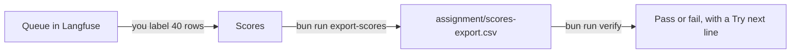

# Label the queue rows

## The problem

You already labelled 40 drafts in a spreadsheet. Now you label the same 40 drafts in a Langfuse annotation queue. Then you check that both ways give the same pass rate.

For example, draft T135 fails in the spreadsheet because "Ribeira Kitchen No. 2" has some steps. In the queue you give T135 the label fail and type the same reason as a comment.



Your files live in `assignment/`, not in this folder. The check reads them there.

## Your challenge

1. Make a free Langfuse Cloud account at cloud.langfuse.com. Make a project. Or start your own with `assignment/docker-compose.yml`.
2. In the project, open Settings, then API Keys. Make a key pair.
3. Add the keys to your `.env` file as `LANGFUSE_PUBLIC_KEY` and `LANGFUSE_SECRET_KEY`. Never type a key in a command.
4. Open the queue link in `assignment/queue-link.md`. The 40 drafts are already loaded.
5. Open the first draft. Read the request and the draft. Choose pass or fail for `mobility-verdict`. Add a comment on every fail.
6. Do the same for all 40 drafts. Check that each row shows the label and comment you gave.
7. Export the scores with the command below.

```bash
bun run export-scores
```

Expect: `Wrote assignment/scores-export.csv: 40 rows.`

8. Check your work.

```bash
bun run verify label-the-queue-rows
```

Expect: `Done. All 2 rules pass.` and a `Progress:` line.

Use the same rubric as in part 2. If you change a label, write one line on why.

## Done when

- The export file `scores-export.csv` is in `assignment/`.
- Every row has one label, pass or fail.

## If you get stuck

Find your `FAIL` line on the left. Do the fix on the right.

| What you see                    | Fix                                                                 |
| ------------------------------- | ------------------------------------------------------------------- |
| `FAIL the export file`          | Run `bun run export-scores`. It writes the file into `assignment/`. |
| `FAIL every row has one label`  | Open the queue. Label every draft once. Then export again.          |
| `The Langfuse keys are missing` | Add both keys to your `.env` file. Then run the export again.       |
| `Langfuse answered 401`         | The keys are wrong. Make a new key pair and copy both parts.        |

## Words you will use

- **Langfuse**: a free tool that stores AI runs and the scores people give them.
- **Annotation queue**: a list of items that wait for a human label.
- **Score**: one label on one item. Here it is pass or fail.
- **Export**: a file with all the scores, so you can check them outside the tool.
